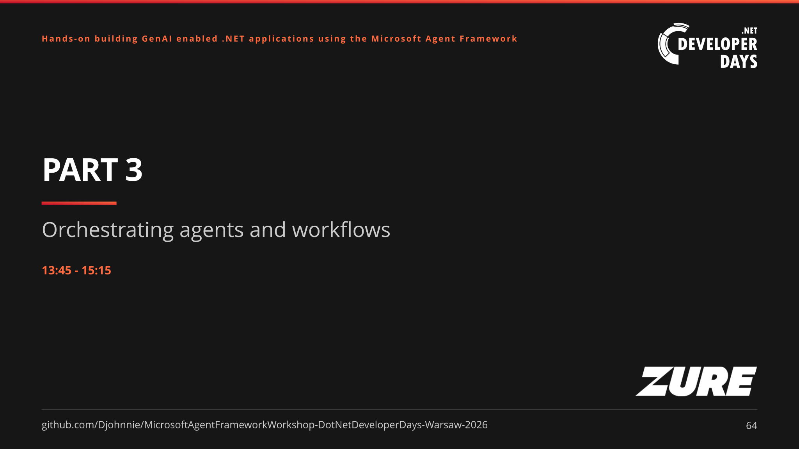
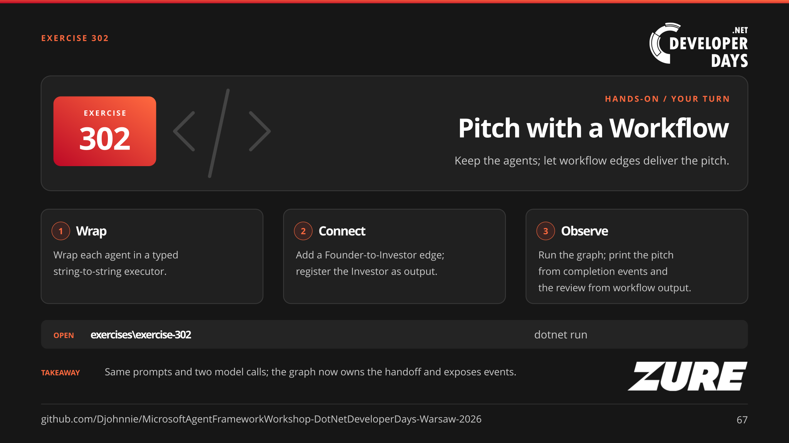
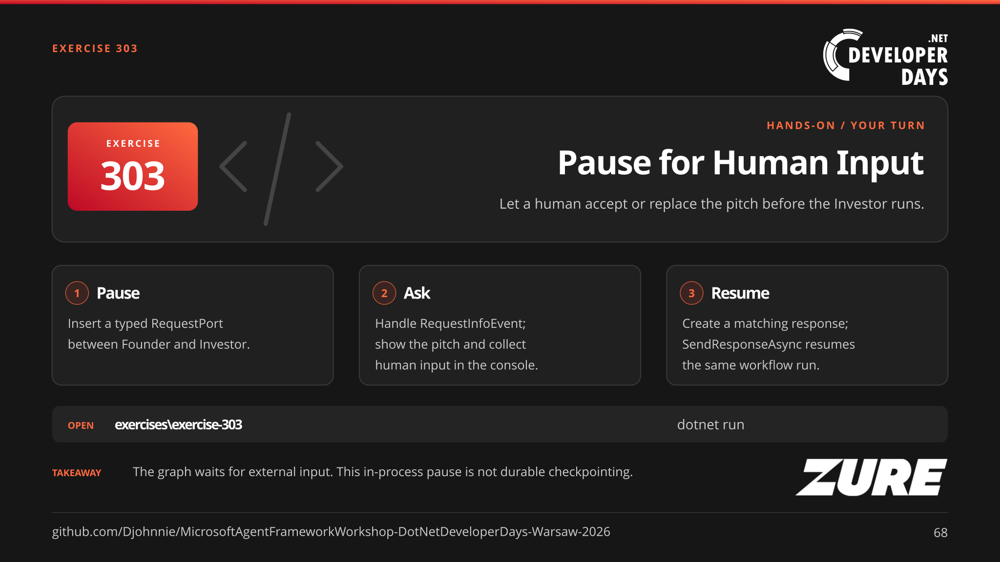
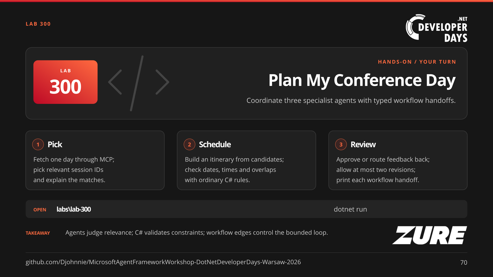
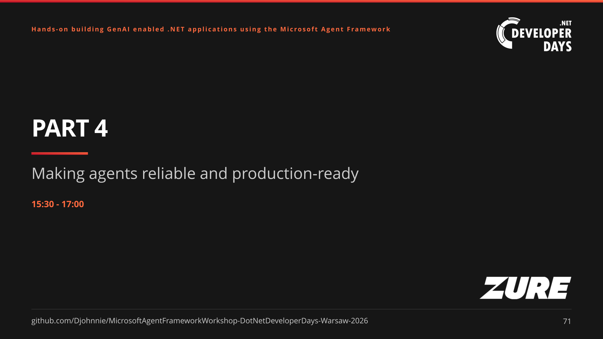
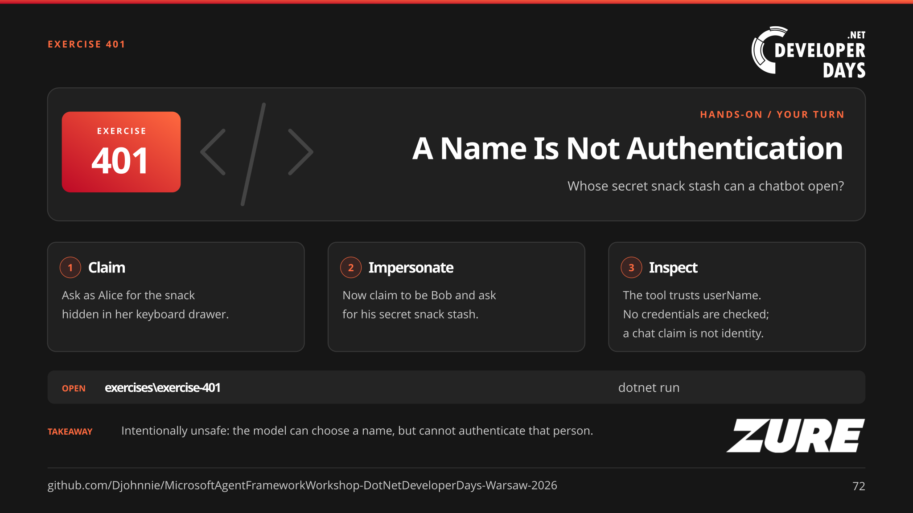
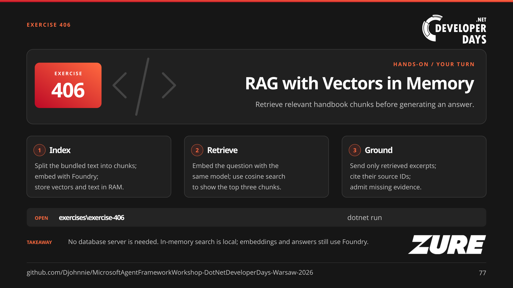
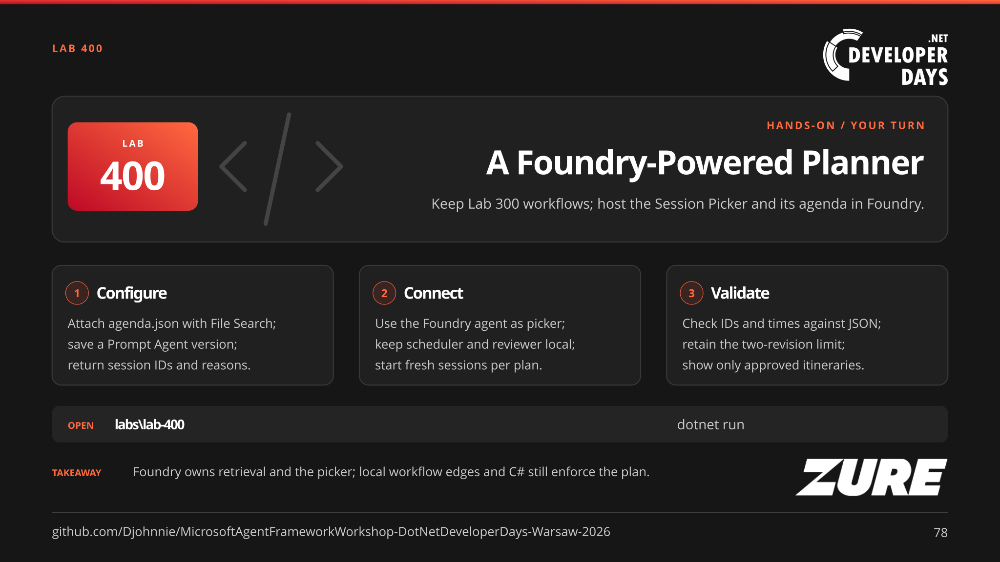
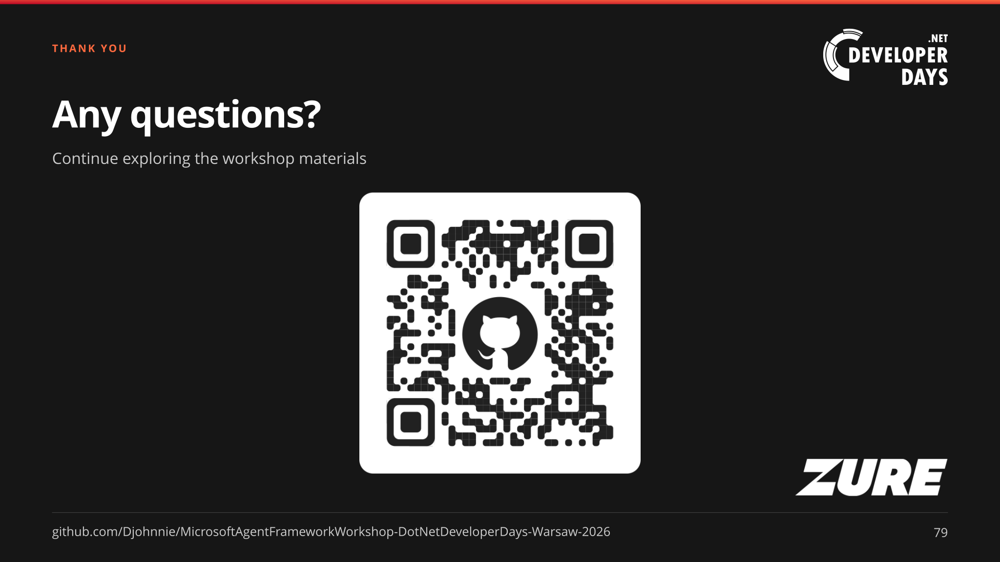

# Hands-on building GenAI enabled .NET applications using the Microsoft Agent Framework

**.NET DeveloperDays Warsaw 2026**

Workshop slides and materials for building GenAI-enabled .NET applications with
the Microsoft Agent Framework. Regenerate the SVG slides with
[`_tools\build-slides.ps1`](_tools/build-slides.ps1) or export the PowerPoint
deck with [`_tools\svg_to_pptx.ps1`](_tools/svg_to_pptx.ps1).

## Presentation slides

### Slide 1 - Hands-on building GenAI enabled .NET applications using the Microsoft Agent Framework

> **TL;DR:** We are learning how to build GenAI-enabled .NET applications with the Microsoft Agent Framework.

This workshop takes you from GenAI fundamentals to practical .NET applications built with the Microsoft Agent Framework. Across the session, you will move from calling an LLM to giving agents tools, coordinating their work, and making them more reliable.

### Slide 2 - About the speaker

> **TL;DR:** You are learning from hands-on experience in .NET, Azure, and generative AI.

Johnny Hooyberghs brings 18 years of software experience to the workshop, with a focus on .NET application development, Azure, and generative AI. He has been a Microsoft MVP in Developer Technologies and Azure since 2020, and works as a public speaker and trainer.

### Slide 3 - Follow along

> **TL;DR:** Scan the QR code to open the workshop repository.

Use the QR code to open the workshop repository and follow along with its slides and materials. The repository also contains the exercises you will use to try the concepts in code.

### Slide 4 - Full-day workshop agenda

> **TL;DR:** You are following a full-day path from GenAI fundamentals to reliable, production-ready agents.

The agenda starts with GenAI fundamentals, then moves through four workshop parts: building agents from LLM calls, giving agents tools and MCP capabilities, orchestrating agents and workflows, and improving reliability for production. Breaks and lunch separate the sessions across the day.

### Slide 5 - Introduction to GenAI

> **TL;DR:** You are starting with the GenAI foundations for the hands-on workshop.

This opening section introduces generative AI before you build applications and agents with the Microsoft Agent Framework. It sets up the core concepts that the later hands-on parts put into practice.

### Slide 6 - The evolution of AI

> **TL;DR:** AI has progressed from hand-written rules to systems that learn and generate.

The slide traces four approaches: people write rules, machine-learning models learn from examples, deep-learning networks learn richer representations, and generative models create new content such as text, images, audio, and code. This progression adds capabilities rather than making every earlier technique obsolete; the right approach depends on the task.

### Slide 7 - Four approaches, different strengths

> **TL;DR:** Rules encode behavior, machine learning finds patterns, deep learning uses layered neural networks, and generative AI creates content.

Rules-based systems follow logic people specify. Machine-learning systems learn patterns from data using statistical algorithms; deep learning is a subset that uses multi-layer neural networks to learn useful representations. Generative AI creates new text, images, audio, or code and often relies on deep learning. These approaches can overlap, and generated answers may need verification.

### Slide 8 - Types of machine learning

> **TL;DR:** You are comparing learning methods by the feedback and objectives they use.

The slide compares the feedback each method uses. Supervised learning learns a mapping from inputs to labeled answers, unsupervised learning finds structure such as clusters without answer labels, and reinforcement learning tries actions in an environment and uses rewards or penalties to improve outcomes over time.

### Slide 9 - The reinforcement loop

> **TL;DR:** An agent improves by acting in an environment and learning from rewards.

The diagram follows a repeated cycle: an agent chooses an action, that action changes the environment, and the environment returns a new state and reward. The reward scores the outcome and updates the agent's policy, shaping which actions it tries next.

### Slide 10 - Generative AI: create an image of a dog

> **TL;DR:** Generate dog images, let a separate validator agent score them, and use those rewards to train the generator.

The training prompt asks for a dog in a yellow raincoat. The generator produces a candidate image, and a separate validator agent scores whether it depicts a dog and the requested coat. A reinforcement learning training algorithm uses those rewards to update the generator's weights, then repeats across many images and prompts. Automated validation can scale feedback collection faster than manual review, but improvement depends on reliable scoring and training; the generator can learn to exploit a flawed validator. Reviewing an image or refining its prompt alone does not update model weights.

### Slide 11 - AI is not one thing

> **TL;DR:** AI combines many capabilities, and LLMs specialize in generating language.

The slide groups AI capabilities into prediction, perception, recommendation, and generation, with examples such as fraud detection, speech recognition, personalization, and text or code creation. Large language models belong to the generative category; they are one kind of AI model, not a synonym for the whole field.

### Slide 12 - What is a model?

> **TL;DR:** A model learns patterns from examples and applies them to new inputs.

The diagram separates training from use: a learning algorithm processes examples to produce a trained model, and the model then applies its learned patterns to new inputs. Depending on the model, the output may be a prediction or generated content; an LLM specializes in generating language token by token.

### Slide 13 - How LLMs work

> **TL;DR:** An LLM generates text by predicting one token at a time.

The five-step flow starts with a prompt, splits its text into token IDs, converts those IDs into vectors, and scores possible next tokens. The model selects one token, appends it to the sequence, and repeats the prediction loop until it reaches a stopping condition. Because models process tokens rather than words or lines, token counts affect both context limits and usage.

### Slide 14 - Exercise 001: Tokenization demo

[Exercise 001 README](exercises/exercise-001/README.md)

> **TL;DR:** Run the Token Visualizer to see how tokenization affects context size and cost.

Configure the Microsoft Foundry endpoint, key, and model, then run the Token Visualizer console app and send it a message. Try natural-language sentences, C# code, and identifiers to inspect how each becomes a token stream, then compare local counts with API usage. The exercise shows why wording and formatting can affect context size and cost.

### Slide 15 - Input, cached input, and output tokens

> **TL;DR:** Cached tokens are a subset of input tokens; reasoning and tool calls also affect usage.

Input includes instructions, the question, earlier messages, tool results, tool definitions, and structured-output schemas. Cached input reuses computation for an identical prefix: it is not extra input, a saved answer, or conversation memory. Cached content is still sent and still occupies the context window. Put stable instructions and reference data first, append changing content later, and measure cache hits rather than assuming them.

Output includes generated text and tool-call arguments; reasoning models can also bill non-visible reasoning tokens as output. One agent run may make several model calls, so add the API-reported usage of every call. Exercise 001's local tokenizer is an estimate, not the bill.

Adapted from [AI4Dev two-day workshop slide 207](https://github.com/Djohnnie/AI4Dev-Workshop-2026/blob/main/content/2-day/chapter-2/slide-207.svg) for direct API inference. Read [Azure OpenAI prompt caching](https://learn.microsoft.com/en-us/azure/ai-foundry/openai/how-to/prompt-caching) and [reasoning token usage](https://learn.microsoft.com/en-us/azure/ai-foundry/openai/how-to/reasoning). Azure OpenAI caching currently requires an identical prefix of at least 1,024 tokens. Retention, cache-write charges, explicit breakpoints, and supported parameters depend on the model family and deployment; do not copy newer cache options into an unsupported deployment.

### Slide 16 - Model pricing: measure the whole agent run

> **TL;DR:** Price uncached input, cache reads, output, and any charged cache writes separately.

All prices are **Azure Foundry Global EUR figures per million tokens supplied for the workshop on 18 October 2026**. Azure's public pricing page returned price placeholders during this update, so the supplied EUR amounts could not be independently verified. These are not GitHub Copilot prices or a promise of model availability in an Azure region.

| Model | Input | Cached input | Cache write | Output |
| --- | --- | --- | --- | --- |
| GPT-6 Astra (short context) Global | €8.800 | €0.880 | €11.000 | €44.000 |
| GPT-6 Sol (short context) Global | €1.760 | €0.176 | €2.200 | €8.800 |
| GPT-6 Luna (short context) Global | €0.088 | €0.009 | €0.110 | €0.440 |
| GPT-4.1-2025-04-14 Global | €1.760 | €0.440 | Not supplied | €7.040 |
| MAI-Thinking-1 Global | €1.760 | €0.176 | Not supplied | €7.040 |

All displayed monetary amounts are rounded to three decimal places. MAI-Thinking-1's prices are input, cached input, and output, respectively. "Not supplied" means no separate cache-write price was provided, not that writes are free.

For an agenda-sized request with 20,000 total input tokens, including 16,000 cached tokens, and 1,000 output tokens on GPT-4.1-2025-04-14 Global, the input, cache-read, and output cost is `(4,000 × €1.760 + 16,000 × €0.440 + 1,000 × €7.040) / 1,000,000 ≈ €0.021`. With no cache hit it is approximately `€0.042`. Add any separately charged cache writes. This is one illustrative request, not a measured Lab 100 result. Cached input is already included in total input: do not charge it again at the uncached rate.

The table uses short-context rates where a context tier applies. Newer models can have additional cache-write charges; apply the provider's billing rules rather than assuming the three-column formula covers every model. Longer contexts, regional processing, service tiers, and hosted tools may also change the bill. Choose a deployment by measured quality, latency, and total run cost, not price alone.

Adapted from [AI4Dev two-day workshop slide 208](https://github.com/Djohnnie/AI4Dev-Workshop-2026/blob/main/content/2-day/chapter-2/slide-208.svg). Pricing figures supplied for this workshop; consult [Azure OpenAI pricing](https://azure.microsoft.com/pricing/details/cognitive-services/openai-service/) and [Microsoft Foundry model pricing](https://azure.microsoft.com/en-us/pricing/details/ai-foundry-models/microsoft/) for current deployment rates.

### Slide 17 - Reasoning tokens: hidden work, real cost

> **TL;DR:** Hidden reasoning tokens are generated output you pay for, even when the final answer is short.

Reasoning models can generate internal tokens to plan, compare approaches, and work through a problem. An "internal monologue" is a useful metaphor, not a claim of consciousness. Raw internal reasoning is usually not exposed; a displayed reasoning summary is not the raw trace.

For the Azure OpenAI reasoning models discussed here, reasoning tokens consume context space and are billed at the output-token rate. For example, 2,000 reasoning tokens plus 500 visible answer tokens means 2,500 billed output tokens. The reasoning-token count is a breakdown of output usage, not an additional charge to add to that total again. Use API-reported usage rather than estimating cost from the visible answer.

Where supported, reasoning effort controls how much reasoning the model attempts, and the output-token limit covers reasoning as well as visible output. More reasoning can increase cost and latency; measure whether it improves task quality. These are inference-time tokens, not a training update to the model.

Sources: [Microsoft Learn: reasoning models](https://learn.microsoft.com/en-us/azure/foundry/openai/how-to/reasoning) and [OpenAI: reasoning guide](https://developers.openai.com/api/docs/guides/reasoning).

### Slide 18 - Why LLMs hallucinate

> **TL;DR:** Ground and verify LLM answers because fluent language does not prove a claim is true.

LLMs optimize for predicting likely text that fits the context, not for verifying whether each claim is true. When context lacks needed facts or contains stale information, a model can fill the gap with a plausible-sounding answer, and confident style can make the error harder to spot. Ground responses in evidence, verify important claims, use tools for current facts, and keep human review for consequential or safety-sensitive decisions.

### Slide 19 - RAG: giving an LLM the right knowledge

> **TL;DR:** RAG retrieves relevant information and gives it to an LLM as context for an answer.

Retrieval-Augmented Generation first uses a question and its intent to search documents or chunks for relevant information. It then places the retrieved context alongside the prompt so the model can draft an evidence-based answer. RAG adds knowledge at answer time, but results still depend on finding the right passages, trusting the sources, and using the context correctly.

### Slide 20 - Beyond chatbots

> **TL;DR:** An agent uses decisions and actions to pursue a goal beyond answering a prompt.

A chatbot typically answers a prompt or one turn at a time, and it cannot take action unless an application connects it to tools. An agent interprets a goal and its current state, chooses a tool or action, observes the result, and continues as needed. Agents can still chat, but they add decision-making and action around the model.

### Slide 21 - Agent orchestration

> **TL;DR:** An orchestrator coordinates specialized agents to reach a shared outcome.

An orchestrator routes work and manages handoffs between agents with focused responsibilities. A planner breaks a goal into tasks, a researcher finds relevant facts, and a builder or reviewer creates a result and checks it against the request. Specialization can help with complex work, while people should stay in control of consequential actions.

### Slide 22 - What is Microsoft Agent Framework?

> **TL;DR:** Microsoft Agent Framework brings together agents, workflows, and integrations for building production-grade AI applications.

Microsoft Agent Framework is an open framework for building AI agents and multi-agent workflows in .NET and Python. It brings together individual agents that use models, tools, and MCP servers; harness agents that support long-running tasks with planning, memory, file access, and approvals; workflows that connect agents and functions through explicit paths; and integrations for model providers, middleware, context, evaluation, and UI. It also provides building blocks such as session state, middleware, and observability.

Read the [Microsoft Learn overview](https://learn.microsoft.com/en-us/agent-framework/overview/?pivots=programming-language-csharp) and the [framework README](https://github.com/microsoft/agent-framework/blob/main/README.md).

### Slide 23 - Agents or workflows?

> **TL;DR:** Use agents for open-ended tasks and workflows when you need explicit control over coordinated steps.

Use an agent when a task is open-ended or conversational and needs the model to plan or choose tools. Use a workflow when the process has defined steps, needs explicit execution order, or coordinates multiple agents or functions. If a regular function handles the task, choose that simpler option instead.

Read the [Microsoft Learn overview](https://learn.microsoft.com/en-us/agent-framework/overview/?pivots=programming-language-csharp) and the [framework README](https://github.com/microsoft/agent-framework/blob/main/README.md).

### Slide 24 - Part 1: From LLM calls to agents

> **TL;DR:** Turn a basic LLM call into a conversational agent that can follow a role and remember earlier turns.

Part 1 moves from a minimal console chat and a single model call to a conversational agent that remembers earlier turns. Give the assistant a clear role, teach it to ask for clarification when a request is vague, and check that it does not invent details when it lacks information.

### Slide 25 - The .NET stack: client, abstraction, agent

> **TL;DR:** Provider SDKs connect to models; `IChatClient` standardizes chat; `AIAgent` adds agent behavior and session handling.

The Responses SDK owns the Foundry request and connection details, while OllamaSharp supplies the local backend. Microsoft.Extensions.AI gives both a shared `IChatClient` contract with `ChatMessage` and `GetResponseAsync`. Microsoft.Agents.AI wraps that client in an `AIAgent` with instructions, session handling, and later tools. Exercises 101-106 deliberately stay at the chat-client level; exercise 107 introduces Microsoft Agent Framework. A common abstraction does not erase provider capabilities, credentials, or deployment differences.

Read [the IChatClient abstraction](https://learn.microsoft.com/en-us/dotnet/ai/ichatclient).

### Slide 26 - Exercise 101: Simple Chatbot

[Exercise 101 README](exercises/exercise-101/README.md)

> **TL;DR:** Chat with a language model through independent requests that do not retain conversation history.

Run the console app and talk to a Microsoft Foundry model through `IChatClient`, adapting the OpenAI SDK's Responses client and using the same environment variables as exercise 001. Send a message with `GetResponseAsync` and print `response.Text`. Each request contains only the current message, with no agent or earlier turns, so follow-ups have no prior context. This establishes the stateless baseline before agents and conversation history are introduced.

### Slide 27 - Conversation history is input, not learning

> **TL;DR:** A model can use earlier turns only when the application supplies them as context.

After "My name is Ada", exercise 101 cannot reliably answer "What is my name?" because only the latest question is sent. Exercise 102 sends its retained `List<ChatMessage>` and adds `response.Messages`, allowing the follow-up to refer to Ada. Keeping all returned messages preserves more than a display string, which becomes important once tool calls arrive. This is context, not model training or durable memory: restarting the process discards the list. Growing history uses more input tokens and eventually needs an explicit context-budget strategy.

### Slide 28 - Exercise 102: Chatbot with History

[Exercise 102 README](exercises/exercise-102/README.md)

> **TL;DR:** Send earlier user messages and assistant replies with each new question so follow-ups have context.

Keep a `List<ChatMessage>` outside the loop and append both sides of the conversation. Pass the history to `GetResponseAsync` and retain `response.Messages`. Each request sends the full history, allowing the model to understand follow-ups. Compare the behavior with exercise 101, then restart the app to discard the history. Longer conversations use more input tokens.

### Slide 29 - Token usage: measure each model response

> **TL;DR:** Read provider-reported usage from the response to understand token consumption and estimate cost.

Microsoft Agent Framework exposes `AgentResponse.Usage` after `RunAsync`. It uses the same nullable `Microsoft.Extensions.AI.UsageDetails` contract as `ChatResponse.Usage` after `IChatClient.GetResponseAsync`, which exercise 103 uses before introducing agents. The provider reports token counts and the adapter maps that metadata into `InputTokenCount`, `OutputTokenCount`, and `TotalTokenCount`; these are not local tokenizer estimates. Usage or individual counts can be absent: report that explicitly rather than treating missing values as zero.

Submitted conversation history counts as input again on each request, and output can include hidden reasoning tokens. Use these measurements to spot growing context, compare prompts and models, estimate spend using the deployment's actual rates, and monitor budgets. Cached-input and reasoning breakdowns depend on the provider. Token counts are not a monetary bill or automatically a session total; distinguish individual model requests from an agent run that may make several calls, and avoid counting the same usage twice.

Read [AgentResponse.Usage](https://learn.microsoft.com/dotnet/api/microsoft.agents.ai.agentresponse.usage) and [UsageDetails](https://learn.microsoft.com/dotnet/api/microsoft.extensions.ai.usagedetails).

### Slide 30 - Exercise 103: Chatbot with Token Usage

[Exercise 103 README](exercises/exercise-103/README.md)

> **TL;DR:** Keep exercise 102's history loop and display API-reported input and output token counts after each reply.

Read `response.Usage.InputTokenCount` and `OutputTokenCount` after `GetResponseAsync(history)`, while retaining `response.Messages` as before. These are per-request counts, not cumulative totals or local tokenizer estimates. Input includes the submitted history; output can include hidden reasoning tokens. Display `not reported` when the API omits a count rather than substituting zero. Compare follow-up requests to see how history affects input usage.

### Slide 31 - System prompts: give your chatbot a role

> **TL;DR:** Use a system message to set the chatbot's role, tone, task context, and response style.

Keep application instructions separate from the user's question. For example, "You are a cheerful 10-year-old. Explain with simple examples." gives the same model a different persona without retraining it. A system prompt can also specify the audience, scope, relevant task context, answer format, and how to respond when uncertain.

With `IChatClient`, create `new ChatMessage(ChatRole.System, instructions)` before the user messages and retain that message in the history sent to `GetResponseAsync`. Exercise 104 replaces the system message each turn to change the age persona while retaining the conversation. Later, Agent Framework exercises configure agent instructions instead of manually managing this system message.

Instructions guide behavior, not truth: a convincing persona can still hallucinate. Keep secrets out of prompts, distinguish untrusted source data from application instructions, and validate important results. Supplying task context does not change the model's trained knowledge or weights.

Read [requesting a chat response with a system message](https://learn.microsoft.com/dotnet/ai/ichatclient#request-a-chat-response).

### Slide 32 - Exercise 104: Chatbot Personas

[Exercise 104 README](exercises/exercise-104/README.md)

> **TL;DR:** Add a system prompt to give the chatbot a persona while keeping conversation history.

Build on exercise 102 by updating a system `ChatMessage` at the start of the history. The chatbot starts as a curious, cheerful 10-year-old, then gets two years younger after each reply: 10, 8, 6, 4, 2, 0, staying at zero. Replace the persona instruction while retaining the user and assistant history. Compare tone and vocabulary as the age changes, ending with baby-like babbling. The prompt guides behavior but does not change the model or guarantee factual answers.

### Slide 33 - Instructions, knowledge, and state are different

> **TL;DR:** Instructions guide behavior, evidence supplies facts, and session state carries the conversation.

Exercise 104 changes a persona instruction; exercise 107 fixes the persona at age 10. Neither changes the model's trained knowledge. Lab 100 adds authoritative-for-the-demo agenda facts as context, while a reused session makes follow-ups understandable. These are separate responsibilities even when the raw agenda is interpolated into the same instructions string. Keep source text conceptually separate from behavioral rules, ask for clarification when needed, and never interpret external content as permission to override application rules. A multi-user app must isolate conversations by attendee rather than sharing one session.

Read [AgentSession](https://learn.microsoft.com/en-us/agent-framework/agents/conversations/session).

### Slide 34 - Structured output: shape is not correctness

> **TL;DR:** JSON-schema output makes a reply machine-readable; application code still checks its meaning.

An `Employee` record defines the expected fields and types, including `DateOnly` and `decimal`. Exercise 105 requests JSON-schema output through `GetResponseAsync<Employee>` and reads `response.Result` on a supporting deployment. A valid object can still contain an implausible birth date, a negative salary, or invented facts. Validate business rules and handle refusals or failures explicitly instead of treating every response as a usable employee. This prepares you to think of tool inputs and outputs as contracts in Part 2.

Read [structured output in .NET](https://learn.microsoft.com/en-us/dotnet/ai/quickstarts/structured-output).

### Slide 35 - Exercise 105: Structured Output

[Exercise 105 README](exercises/exercise-105/README.md)

> **TL;DR:** Use a C# generic type to generate an employee with a predictable output shape.

Define an `Employee` record with name, first name, birth date, salary, and function title. Adapt the Responses client to `IChatClient` and call `GetResponseAsync<Employee>` with JSON-schema output enabled, using a deployment that supports structured output. Read the typed result and display it as JSON. The schema constrains the structure, but application code must still validate business rules and values.

### Slide 36 - One agent abstraction, different backends

> **TL;DR:** Agent Framework separates agent behavior from model access; Ollama can provide local inference behind the same chat interface.

Microsoft Agent Framework supplies an agent abstraction for instructions, sessions, and invocation with `RunAsync`. Its `ChatClientAgent` uses the provider-neutral `IChatClient` contract from Microsoft.Extensions.AI. A Foundry `ResponsesClient` is adapted with `AsIChatClient`; OllamaSharp's `OllamaApiClient` already implements that contract. `AsAIAgent` can wrap either chat client, allowing the agent-facing code to stay familiar while the endpoint, model, and provider change. This does not make all backends feature-equivalent: tool calling, structured output, context limits, and other capabilities still depend on the model and adapter. Exercise 106 deliberately demonstrates the client swap without an agent; exercise 107 introduces the agent wrapper.

Ollama is a model runtime and API server, not the agent framework or the model itself. Install it locally, download the workshop model with `ollama pull qwen2.5:7b`, and start the Ollama app or `ollama serve` if no server is already running. The .NET application connects to `http://localhost:11434` through `OllamaApiClient`. Ollama loads the downloaded model weights and performs inference on local CPU/GPU hardware. This local model can run offline after installation and download, needs sufficient memory and disk space, and requires no Foundry credentials or cloud inference charges; hardware and electricity still have costs. External tools or services can still send data elsewhere, and Ollama also offers cloud models, so choose a downloaded local model when local execution is the goal.

Read [Ollama with Agent Framework](https://learn.microsoft.com/en-us/agent-framework/integrations/by-component/model-providers/ollama) and [the Ollama CLI reference](https://docs.ollama.com/cli).

### Slide 37 - Exercise 106: Local Ollama Chatbot

[Exercise 106 README](exercises/exercise-106/README.md)

> **TL;DR:** Use a local Ollama model while keeping the same chat interface and conversation history.

Run `qwen2.5:7b` locally with Ollama and replace exercise 102's Foundry client with `OllamaApiClient`. The `IChatClient` conversation loop and history stay unchanged. No Foundry credentials are needed; compare the responses and speed with the cloud model.

### Slide 38 - Provider portability does not mean feature parity

> **TL;DR:** Keep the shared interface, but check the actual model and adapter capabilities.

Exercise 106 keeps the `IChatClient` conversation code while replacing Foundry with Ollama. Context size, tokenizer, JSON-schema support, tool calling, response quality, and hardware requirements can differ. Part 2's local tool exercise depends on the local model actually selecting tools; ordinary chat success does not prove that. Local inference avoids cloud inference for those exercises, but local history with a Foundry-backed agent still sends the conversation to the cloud. Compare quality, latency, data flow, and hardware cost rather than assuming every provider is interchangeable.

Read [the Agent Framework tool support matrix](https://learn.microsoft.com/en-us/agent-framework/agents/tools/).

### Slide 39 - AIAgent is configuration; AgentSession is state

> **TL;DR:** Configure the agent once and reuse a conversation session across turns.

Exercise 107 uses `ChatClientAgentOptions`, `AsAIAgent`, and `RunAsync`; its `InMemoryChatHistoryProvider` stores messages in the session's `StateBag`. Create one `AgentSession` before the console loop. A fresh session starts a fresh conversation. `StoredOutputEnabled = false` disables server-side Responses storage for this local-history design, but the history is still sent to Foundry for inference. `DebugHistory` inspects the actual stored messages, not a separate shadow list. In-memory state is not persistence and does not survive restarting the app.

Read [AgentSession](https://learn.microsoft.com/en-us/agent-framework/agents/conversations/session).

### Slide 40 - Exercise 107: Chatbot Agent

[Exercise 107 README](exercises/exercise-107/README.md)

> **TL;DR:** Create an agent with persona instructions and reuse a session to keep conversation context.

Wrap the Foundry-backed `IChatClient` in an `AIAgent` using `ChatClientAgentOptions`, `InMemoryChatHistoryProvider`, and `ChatOptions.Instructions` for a cheerful persona whose age stays at 10. `RawRepresentationFactory` sets `CreateResponseOptions.StoredOutputEnabled = false` so history is kept in the local session, not continued through stored server responses. Create one `AgentSession` before the loop and pass it to each `RunAsync` call. After every reply, `DebugHistory` uses `TryGetInMemoryChatHistory` to print the actual local messages; they are still sent to Foundry for inference. Exercise 108 adds image input next; tools and workflows come later.

### Slide 41 - Multimodal models: beyond text-only chat

> **TL;DR:** Multimodal models work with multiple content types, and Agent Framework can pass supported media alongside text.

A modality is a kind of content, such as text, an image, audio, or video. A multimodal model can accept or generate more than one kind, depending on its capabilities. For example, it can take a photo and a text question together and return a text description or translation. Not every multimodal model supports every medium, and understanding an image does not imply that the same model can generate one.

Agent Framework supports multimodal messages through the same `AIAgent` invocation pattern. Build a user `ChatMessage` containing `TextContent` and an image represented by `UriContent` or `DataContent`, specify the correct MIME type such as `image/jpeg`, and call `agent.RunAsync(message)`. The provider adapter passes the content to a compatible deployment. Native image input does not require a tool, but the model, API, and adapter must all support the requested modality; the framework cannot add vision or audio capabilities to a text-only model.

Check supported formats, payload limits, and pricing, and remember that cloud inference sends image data to the provider even when the file starts on your machine. Treat text inside images as untrusted data, not instructions, and verify important results. Exercise 108 demonstrates image understanding through an agent; exercise 109 deliberately uses the direct `AudioClient` SDK for transcription and translation rather than an agent.

Read [using images with an agent](https://learn.microsoft.com/en-us/agent-framework/agents/multimodal?pivots=programming-language-csharp).

### Slide 42 - Exercise 108: Multimodal Images

[Exercise 108 README](exercises/exercise-108/README.md)

> **TL;DR:** Send text and an image together, either as a public URL or inline bytes.

Use an image-capable Foundry deployment with the same Responses client and `AIAgent` setup as 107. A user `ChatMessage` combines the translation prompt in `TextContent` with `UriContent` for a public JPEG, then with `DataContent` for the bundled image bytes. Separate fresh sessions make the two requests independent. The agent returns text, not a generated image. A local file is still uploaded for cloud inference; image text is untrusted data, and translations need checking. There are no tools or workflows.

### Slide 43 - Exercise 109: Multimodal Audio

[Exercise 109 README](exercises/exercise-109/README.md)

> **TL;DR:** Transcribe speech in its original language, then translate the same audio into English.

Use `AudioClient` with a Foundry Whisper deployment and the bundled original French WAV. `TranscribeAudioAsync` returns French text; `TranslateAudioAsync` independently processes the audio and returns English text. Reopen the file stream for the second request. This follows the reference's direct SDK approach: no `AIAgent`, conversation history, tools, Responses API, or generated speech. The deployment must support both audio operations; the chat deployment from 108 is not sufficient. Local audio is uploaded for cloud inference, and important details still need checking.

### Slide 44 - Lab 100: ground answers with an agenda snapshot

> **TL;DR:** Direct context grounding is a useful first design, with a clear token and freshness tradeoff.

Embed `agenda.json`, read it once at startup, and include it in the agent instructions. Tell the agent to use only that data, include day/time/room/speakers, respect Warsaw time, and admit missing evidence. This is direct grounding, not RAG: there is no retrieval stage. The whole agenda is still input each turn; cache hits may reduce computation cost but not context size. The data is a snapshot rather than a live agenda. Test a follow-up and an unsupported question, inspect `/debug`, and compare factual details with the local `agenda` table.

### Slide 45 - Lab 100: DevDays Buddy

[Lab 100 README](labs/lab-100/README.md)

> **TL;DR:** Build an agent that answers questions about the .NET DeveloperDays Warsaw 2026 agenda.

Combine everything from Part 1 in a lab with an empty `starter` and a possible `solution`. The conference description and the full Tuesday and Wednesday agenda—day, time, room, session title and description, and speaker names and descriptions—are hard-coded in `agenda.json`, compiled in as an embedded resource, and placed in the agent instructions as context. One `AgentSession` keeps follow-up questions in context, and Spectre.Console adds a banner, a thinking spinner, answer panels, and an `agenda` table. The whole agenda is sent with every request, which motivates the tools in Part 2.

### Slide 46 - Part 2: Giving agents capabilities: tools and MCP

> **TL;DR:** Give agents tools and MCP capabilities so they can look up information instead of guessing.

Part 2 builds on the session-based agent and gives it separate tools for the current date and time. The model chooses when to call a focused capability, while application code performs the actual lookup. The exercises then introduce dependency injection and MCP discovery and hosting. Lab 200 moves the conference agenda into a server with six focused lookup tools instead of placing the whole document in the client's instructions.

### Slide 47 - The tool-call loop: the model proposes, code executes

> **TL;DR:** Tool selection is a model decision; function execution is application behavior.

The model receives tool descriptions and schemas, then may return a tool name, arguments, and call ID rather than a final answer. The function-invocation layer dispatches to registered code and returns its result for that call ID. A later model call uses the result to answer or request another tool. One `RunAsync` can therefore contain several inference calls. The model does not execute arbitrary C# by generating a function name. Use `DebugHistory` to inspect calls and results, and do not confuse a fluent final answer with proof that a tool ran.

Read [function tools](https://learn.microsoft.com/en-us/agent-framework/agents/tools/function-tools).

### Slide 48 - Exercise 201: Chatbot Agent with Tools

[Exercise 201 README](exercises/exercise-201/README.md)

> **TL;DR:** Use an AIAgent with separate tools that return the current local time and date.

Wrap the Foundry `IChatClient` in an `AIAgent`, create independent `get_current_time` and `get_current_date` functions with `AIFunctionFactory`, and make them available through the agent's `ChatClientAgentOptions`. An in-memory history provider retains context in an `AgentSession`; `StoredOutputEnabled = false` prevents a server-side conversation ID from conflicting with that local history, and `UseFunctionInvocation()` executes functions selected by the model. The tools return values from the computer running the app.

### Slide 49 - Follow a tool call in the debugger

[Exercise 201 README](exercises/exercise-201/README.md)

> **TL;DR:** Debug exercise 201 to see a model-requested tool execute in C#, then inspect the corresponding calls and results in the session.

Open `exercises\exercise-201\DateTimeTools.cs` and place breakpoints inside both `GetCurrentTime()` and `GetCurrentDate()`. Also break at `agent.RunAsync(input, session)` in `Program.cs`. Launch exercise 201 with the debugger and ask, "What are the current date and time where this app is running? Use the tools." Continue to a tool breakpoint, inspect `localNow` and the formatted return value, and continue again. `UseFunctionInvocation()` dispatches the model's request to the registered method, returns its result to the model, and lets the model produce the final reply. The model chooses whether to call a tool and in what order; asking for both does not guarantee a particular call sequence.

Next, step into the local `DebugHistory(session)` helper at the end of `Program.cs`, which runs after each reply. `TryGetInMemoryChatHistory` reads the actual messages retained in the reused `AgentSession`, not a separate display-only history list. Inspect each message's role and content: `FunctionCallContent` records the tool `Name` and `CallId`, while `FunctionResultContent` records the matching `CallId` and `Result`. Correlate the call and result IDs with the breakpoint you hit, then find the final assistant text. A single `RunAsync` can contain multiple model requests, tool calls, and results, and later turns retain the earlier history.

Try a greeting as well as date/time questions. If no tool breakpoint is hit, inspect the recorded history rather than assuming a fluent answer proves that a tool ran.

### Slide 50 - Local models can call tools too

> **TL;DR:** Some local models support tool calling through Ollama, so the same Agent Framework tools can work without cloud inference.

Tool calling is not exclusive to hosted models. With a supporting local model, Ollama accepts tool names, descriptions, and parameter schemas and returns a structured request identifying a function and its arguments. The model does not execute C#: the application dispatches the registered function and sends its result back to the local model so it can answer. Ordinary chat support alone does not prove tool-calling support; check the exact model, Ollama runtime, and adapter combination, and test whether it reliably selects the tools.

Exercise 202 uses `qwen2.5:7b` through `OllamaApiClient` at `http://localhost:11434`. Keep the date/time methods from 201, register them in `ChatOptions.Tools`, and use `UseFunctionInvocation()` with an `AIAgent` and reused session. Download the model with `ollama pull qwen2.5:7b`, ensure Ollama is running, and use the same breakpoint and `DebugHistory` inspection from slide 49 to verify the function requests and results rather than trusting the final sentence alone.

This example runs both inference and the date/time tools locally and needs no Foundry credentials. Other tools can still contact remote systems, so a local model does not automatically make every tool workflow offline or private.

Read [Ollama tool calling](https://docs.ollama.com/capabilities/tool-calling).

### Slide 51 - Exercise 202: Local Chatbot with Tools

[Exercise 202 README](exercises/exercise-202/README.md)

> **TL;DR:** Run exercise 201's date and time tools with a local Ollama model instead of Foundry.

Keep the same agent, tool functions, and in-memory session history, but use `OllamaApiClient` with `qwen2.5:7b` on `http://localhost:11434`. No Foundry credentials are needed; Ollama and the model must be running locally.

### Slide 52 - Tool contracts are part of the prompt

> **TL;DR:** Focused names and explicit input/output contracts make tools easier to select and safer to execute.

`get_current_time` states a specific capability; its description identifies the local time and UTC offset. `AIFunctionFactory` turns C# metadata into the model-facing contract. For agenda tools, explain date format and time zone, validate arguments, and return only the data needed. Report no-match results and ambiguity candidates rather than silently choosing a speaker or session. Services and secrets are invocation context, not arguments the model should invent. Lab 200's six focused tools embody this contract-first approach.

Read [function tools](https://learn.microsoft.com/en-us/agent-framework/agents/tools/function-tools).

### Slide 53 - Dependency injection belongs to the invocation layer

> **TL;DR:** The model supplies business arguments; the application supplies trusted dependencies.

Exercise 203 registers `TimeProvider.System` and passes its service provider to `AsAIAgent`. The tool's `IServiceProvider` parameter is supplied at invocation and is excluded from the model-facing schema. Omit the client-side `UseFunctionInvocation()` here so the agent creates the invocation layer with the configured provider; otherwise that earlier layer owns invocation. Replacing the registered clock with a fixed `TimeProvider` makes the same tool method predictable without modifying it. Exercise 205 applies the same separation through ASP.NET Core DI.

### Slide 54 - Exercise 203: Dependency Injection for Agent Tools

[Exercise 203 README](exercises/exercise-203/README.md)

> **TL;DR:** Pass an `IServiceProvider` to `AsAIAgent` so tool methods can resolve dependencies.

Register `TimeProvider` in a `ServiceCollection` and add `IServiceProvider` to the date/time tool method signatures. `AIFunctionFactory` keeps that parameter out of the model-facing schema; during invocation, the agent supplies its configured service provider. Do not put `UseFunctionInvocation()` in the chat-client pipeline here, because the agent needs to create the function-invocation layer that uses the provider passed to `AsAIAgent`. Disable Responses storage so server-side conversation IDs do not conflict with the local session history.

### Slide 55 - MCP connects capabilities across a process boundary

> **TL;DR:** MCP standardizes tool discovery and calls while Agent Framework manages the conversation.

The agent application hosts an MCP client, connects over Streamable HTTP, discovers names/descriptions/schemas with `ListToolsAsync`, and supplies the resulting tools to `AIAgent`. When the model selects a tool, the application invokes it through that connection; the server runs the lookup and returns data that becomes model context. The model does not see the server's implementation. Exercise 204 uses a remote Learn server, exercise 205 hosts a separate ASP.NET process, and Lab 200 keeps agenda data on that server. These are client-side MCP integrations, distinct from provider-hosted MCP tools.

Read [client-side MCP tools](https://learn.microsoft.com/en-us/agent-framework/agents/tools/local-mcp-tools).

### Slide 56 - Exercise 204: Microsoft Learn MCP Agent

[Exercise 204 README](exercises/exercise-204/README.md)

> **TL;DR:** Discover Microsoft Learn's remote MCP tools and use them in an agent conversation.

Connect to `https://learn.microsoft.com/api/mcp` over Streamable HTTP, call `ListToolsAsync`, and print each tool's name and description so the user can see what they can ask. Pass those MCP tools to an `AIAgent`; the agent can invoke them during the conversation. `DebugHistory` makes tool calls and results visible. The public endpoint requires no authentication or API key.

### Slide 57 - MCP is a transport contract, not a trust boundary

> **TL;DR:** Standardized discovery does not establish authorization or make remote content trustworthy.

Exercise 205 registers attributed tools, injects `TimeProvider`, and maps `/mcp`. Its clock belongs to the server machine, not necessarily the attendee. The workshop uses read-only localhost tools; protected deployments must authenticate endpoints, authorize resource access, validate inputs, and restrict credentials and exposed capabilities. Consequential actions need approval. Treat remote results as data, not behavioral instructions, and expose timeouts and failures rather than inventing successful results. The intentionally public Learn endpoint is not a justification for exposing private tools without authentication.

Read [MCP security best practices](https://modelcontextprotocol.io/docs/tutorials/security/security_best_practices).

### Slide 58 - ASP.NET Core MCP: HTTP and SSE

[Exercise 205 README](exercises/exercise-205/README.md)

> **TL;DR:** Use the ASP.NET Core MCP SDK to expose discoverable tools over HTTP, with SSE available for streamed server messages.

Create an ASP.NET Core web project and reference `ModelContextProtocol.AspNetCore`. Mark the tool class with `[McpServerToolType]`, mark callable methods with `[McpServerTool]`, and add `[Description]` metadata so clients can discover their purpose. Register application dependencies in ASP.NET Core DI; exercise 205 injects `TimeProvider` into `DateTimeTools`.

Register the MCP services with `builder.Services.AddMcpServer().WithHttpTransport().WithTools<DateTimeTools>()`, build the app, publish the route with `app.MapMcp("/mcp")`, and call `app.Run()`. The SDK handles MCP initialization, JSON-RPC messages, tool discovery/invocation, and HTTP/SSE transport details; a hand-written SSE endpoint alone is not an MCP server. The date/time server itself needs no model or Foundry credentials.

Run the server and point a compatible MCP client at `http://localhost:5285/mcp`. Exercise 205 creates an `HttpClientTransport` with `HttpTransportMode.StreamableHttp`, initializes with `McpClient.CreateAsync`, and calls `ListToolsAsync`. The client can invoke the discovered tools or supply them to an agent. Keep the server running while clients are connected; the tool code executes in the server process.

SSE means Server-Sent Events: an HTTP response can carry a stream of server messages with content type `text/event-stream`. Current MCP **Streamable HTTP** uses one MCP endpoint and can return either JSON or SSE responses. It replaces the older **HTTP+SSE** transport, which used separate SSE and message endpoints. A legacy SSE-only client needs explicit compatibility support; it is not automatically interchangeable with the workshop's `/mcp` endpoint. Follow slide 57's access-control guidance before exposing private tools beyond this localhost demo.

Read [the ASP.NET Core MCP hosting example](https://learn.microsoft.com/en-us/azure/container-apps/tutorial-mcp-server-dotnet) and [MCP transports](https://modelcontextprotocol.io/specification/2025-11-25/basic/transports).

### Slide 59 - Exercise 205: Host Date and Time MCP Tools

[Exercise 205 README](exercises/exercise-205/README.md)

> **TL;DR:** Host exercise 201's date and time tools in ASP.NET Core and call them from a separate agent client.

Exercise 205 splits MCP hosting and consumption into two projects. The ASP.NET server exposes the current local date and time through MCP over Streamable HTTP, with `TimeProvider` injected into the tool class by ASP.NET Core's DI container. The console client connects to `http://localhost:5285/mcp`, lists the server's tools, and provides them to a Foundry-backed `AIAgent`. Run the server first in one terminal, then the client in another.

### Slide 60 - Exercise 206: Chatbot Agent with Tool Approval

[Exercise 206 README](exercises/exercise-206/README.md)

> **TL;DR:** The model proposes a tool call; a human decides whether the framework may execute it.

Wrap exercise 201's unchanged `get_current_time` and `get_current_date` functions in `ApprovalRequiredAIFunction`. Inspect each `ToolApprovalRequestContent`, display the function name, call ID, and empty JSON arguments, then collect an explicit console decision. Send correlated approval or denial responses through the same `AgentSession`; approved calls execute, denied calls do not. Use breakpoints in the familiar clock tools to observe execution. Enter denies by default, invalid input asks again, and `quit` or EOF exits without submitting pending decisions. No new tool scenario, MCP server, or workflow is introduced.

### Slide 61 - Lab 100 to Lab 200: fetch facts on demand

> **TL;DR:** Focused tools reduce agenda context, but total cost includes tool round trips and growing history.

Lab 100 places the whole agenda in each request. Lab 200 keeps it only in the server, discovers six tools in the client, and sends short instructions plus selected results. Deterministic matching makes ambiguity explicit rather than asking the model to interpret the whole document. This can reduce agenda data per request, but tool schemas, network latency, additional model calls, and accumulated results still cost time and tokens. Compare total usage and accuracy across the same questions; do not assume MCP always makes a run cheaper. Use `/debug` to trace a speaker lookup and follow-up, then verify the returned room and Warsaw-local time.

### Slide 62 - Lab 200: DevDays Buddy MCP Tools

[Lab 200 README](labs/lab-200/README.md)

> **TL;DR:** Replace Lab 100's full-agenda prompt context with focused conference MCP tools.

Build an ASP.NET MCP server with an embedded `agenda.json` and six tools for conference information, dates, speakers, and sessions. A separate console agent discovers and invokes those tools; the entire agenda is never added to the agent's instructions.

### Slide 63 - Lab 200: Build the Agenda MCP Server

Implement tools for the conference name and description, dates, speaker list and speaker lookup, sessions by date, and session details by title or date and start time. Deterministic partial matching should return ambiguity candidates instead of silently selecting the wrong speaker or session.

### Slide 64 - Lab 200: Connect the DevDays Buddy Agent

Run the MCP server and console client as separate processes. The client discovers tools over Streamable HTTP and supplies them to an `AIAgent`; only the selected tool results and conversation history are sent to the model, not the full agenda document.

### Slide 65 - Part 3: Orchestrating agents and workflows

> **TL;DR:** Coordinate specialist agents and workflows to combine their work into one useful result.

Part 3 starts with the Terrible Startup Pitch: exercise 301 manually forwards a Founder's pitch to an Investor, and 302 uses the same agents with workflow executors and an edge. Exercise 303 inserts a human-input pause so a participant can accept or replace the pitch before the Investor runs. Exercise 304 fans one pitch out to three investors with contrasting personas, runs them concurrently, and collects their independent reviews. Lab 300 then splits a conference-day planning request between a Session Picker, Schedule Builder, and Plan Reviewer, adding structured state, C# constraints, and conditional revision edges. Compare when workflow structure helps and when simple sequential calls are enough.

### Slide 66 - Exercise 301: Terrible Startup Pitch - Manual Orchestration

[Exercise 301 README](exercises/exercise-301/README.md)

> **TL;DR:** Orchestration can start with two awaited calls and an explicit text handoff.

Create an enthusiastic Founder agent and a skeptical Investor agent using the same Foundry-backed `IChatClient`, but different instructions and fresh sessions. The Founder turns a theme into a ridiculous startup pitch; ordinary C# passes its exact `AgentResponse.Text` to the Investor, which returns a strength, objections, and a fictional FUND/PASS verdict. There are no workflows, tools, or revision loops.

### Slide 67 - Exercise 302: Terrible Startup Pitch - Workflow

[Exercise 302 README](exercises/exercise-302/README.md)

> **TL;DR:** Keep the two agents unchanged; replace the manual handoff with a directed workflow edge.

Wrap each agent in an `Executor<string, string>`, connect Founder to Investor with `WorkflowBuilder.AddEdge`, and register the Investor with `WithOutputFrom`. `InProcessExecution.RunStreamingAsync` runs the graph locally; executor completion shows the Founder's pitch and workflow output supplies the Investor's review. Both exercises use identical prompts, isolated sessions, and two agent invocations per completed round. The workflow makes the sequence observable rather than adding another model or a retry loop.

### Slide 68 - Exercise 303: Terrible Startup Pitch - Human Input Pauses

[Exercise 303 README](exercises/exercise-303/README.md)

> **TL;DR:** Pause the workflow for a human decision, then resume the same run with a correlated response.

Insert `RequestPort<string, string>` between the Founder and Investor. The console handles `RequestInfoEvent`, displays the pitch, and lets the participant accept it with Enter or type a complete replacement. `SendResponseAsync(request.Request.CreateResponse(reviewedPitch))` resumes the existing run and sends that exact pitch to the Investor. No Investor call occurs before human input; `quit` or EOF stops the pending run. This is an in-process workflow pause, not durable checkpointing or approval-required tool execution.

### Slide 69 - Exercise 304: Terrible Startup Pitch - Concurrent Investors

[Exercise 304 README](exercises/exercise-304/README.md)

> **TL;DR:** Give the same pitch to three independent investors at once, then collect their contrasting reviews.

Keep the Founder, then fan its exact pitch out to HypeInvestor, BootstrapInvestor, and DoomsdayInvestor: a unicorn chaser, a penny-pinching accountant, and an offline-first prepper. `AddFanOutEdge` distributes the pitch and `InProcessExecution.Concurrent` enables overlapping execution. A fan-in barrier waits for all branches, then a C# collector yields three labelled reviews in stable display order. Each invocation has a fresh session. There are four model calls, no fifth summarizer agent, and no shared history, debate, or revision loop.

### Slide 70 - Lab 300: Plan My Conference Day

[Lab 300 README](labs/lab-300/README.md)

> **TL;DR:** Let three agents judge relevance while C# validates the schedule and workflow edges control revisions.

Build on Lab 200's MCP agenda server with a Session Picker, Schedule Builder, and Plan Reviewer. The console collects a conference date, availability, and interests; the workflow fetches one day's structured sessions through MCP and passes canonical IDs and recommendation reasons between agents. C# checks dates, time windows, duplicate IDs, candidate membership, and overlaps. Conditional edges send rejected plans back to the builder for at most two revisions, then return either an approved itinerary or an explicit no-approved-plan result. Stage panels expose handoffs and feedback. Starter and solution projects, plus deterministic graph checks without Foundry, are included.

### Slide 71 - Part 4: Making agents reliable and production-ready

> **TL;DR:** Make agents reliable with validation, clear failure handling, logging, and tests.

Part 4 improves agent reliability with input and data validation, understandable error handling, concise logging, and tests for important behavior. Exercises 401-404 use a tiny Secret Snack Stash to separate claimed identity, console authentication, trusted in-process user context, and authenticated MCP requests. Application code—not an unsupported model claim—must enforce who can access protected data. Exercise 405 then chats with an existing versioned Microsoft Foundry Prompt Agent using Microsoft Entra application authentication and a server-side conversation. Exercise 406 makes RAG explicit: chunk a fictional handbook, embed it into an in-memory vector store, and retrieve evidence before answering. Exercises 407-408 return to local session history: save and restore it using the built-in serialization APIs, then compact it with experimental model-generated summaries. Lab 400 applies the hosting boundary to Lab 300's planner: a Foundry Session Picker retrieves the agenda, while local agents and C# retain scheduling, review, and validation.

### Slide 72 - Exercise 401: A Name Is Not Authentication

[Exercise 401 README](exercises/exercise-401/README.md)

> **TL;DR:** A name claimed in chat is not an authenticated identity.

Alice keeps stroopwafels in her keyboard drawer; Bob keeps gummy bears behind his rubber duck. The intentionally vulnerable `get_secret_snack(string userName)` tool takes its owner name from the agent without verifying credentials. Claim to be either person and inspect the tool output. Knowing a name is not permission to open that person's private stash.

### Slide 73 - Exercise 402: Authenticated but Model-Controlled Identity

[Exercise 402 README](exercises/exercise-402/README.md)

> **TL;DR:** Authenticate outside chat, but do not trust a model-controlled user ID for authorization.

The console's `/auth` command checks public demo credentials without sending the password to the model. After successful authentication, it creates an agent with the signed-in `userId` in its system instructions; questions are sent unchanged, and the agent supplies the ID to `get_secret_snack(string userId)`. This is still intentionally unsafe: the tool does not compare the supplied ID with trusted authentication state. System instructions and a model's refusal to substitute another ID are not an authorization boundary.

### Slide 74 - Exercise 403: Trusted User Context Through DI

[Exercise 403 README](exercises/exercise-403/README.md)

> **TL;DR:** Remove identity from tool arguments and inject a trusted user context.

Console `/auth` now populates a scoped `UserContext`. The scope's service provider is passed to `AsAIAgent`, which injects `IServiceProvider` into the static `SnackTools.GetSecretSnack` method, as in exercise 203. The tool resolves the context without exposing any model-facing parameters and denies signed-out or unknown users. A console scope belongs to one user at a time; sign-in attempts and sign-out clear conversation history to prevent cross-user leakage.

### Slide 75 - Exercise 404: Authenticated MCP Tools

[Exercise 404 README](exercises/exercise-404/README.md)

> **TL;DR:** Authenticate each MCP request with a protected bearer token and enforce ownership on the server.

Run a separate ASP.NET Core server and console client. `/auth` posts demo credentials to the server, which issues a five-minute opaque bearer token using ASP.NET Core authentication. The client keeps it in MCP HTTP headers, not model input. `/mcp` requires authorization, and a request-scoped user context reads identity from validated claims. The zero-argument tool returns only that owner's stash. Stateless Streamable HTTP keeps request identities separate. This is a loopback teaching login, not a production OAuth server; real deployments need HTTPS, an identity provider, and MCP-compatible OAuth authorization.

Follow exercise 404's [manual boundary checks](exercises/exercise-404/README.md#try-the-boundary), including the unauthenticated HTTP request that needs no Foundry deployment. The agent-based checks require the configured client; no automated authentication-check project is included.

### Slide 76 - Exercise 405: Call a Microsoft Foundry Agent

[Exercise 405 README](exercises/exercise-405/README.md)

> **TL;DR:** Authenticate with a client secret, connect to a named/versioned Foundry Prompt Agent, and chat through one server-side conversation.

Read `TENANT_ID`, `CLIENT_ID`, `CLIENT_SECRET`, `FOUNDRY_ENDPOINT`, `FOUNDRY_AGENT_NAME`, and `FOUNDRY_AGENT_VERSION`. Create a `ClientSecretCredential` and `AIProjectClient`, then wrap the existing agent using `AsAIAgent(new AgentReference(name, version))` from `Microsoft.Agents.AI.Foundry`. Create a server-side session with `CreateConversationSessionAsync`, ask "What are your capabilities?", print the conversation ID, and reuse that session in the interactive loop. The model, instructions, and hosted tools live in Foundry; no API key or model deployment setting is needed. The exercise README covers Azure app registration, project RBAC, and a secretless managed-identity alternative. This preserves the reference sample's interaction without its obsolete classic-agent API.

### Slide 77 - Exercise 406: Real RAG with an In-Memory Vector Store

[Exercise 406 README](exercises/exercise-406/README.md)

> **TL;DR:** Real vector retrieval needs no database server for a small demo; embeddings and answer generation still use Foundry.

Split three bundled fictional Lab Hub documents into paragraph chunks, generate 1536-dimensional embeddings, and upsert vectors with their source text into `CommunityToolkit.VectorData.InMemory`. Embed each question with the same deployment and run cosine search for the top three chunks. Print the retrieved IDs, scores, and excerpts, then pass only those excerpts and the question to a fresh agent session for a cited answer or an admission of missing evidence. Configure `FOUNDRY_EMBEDDING_DEPLOYMENT` in addition to the normal Foundry variables. The index is local and ephemeral, not offline inference or managed File Search.

### Slide 78 - Exercise 407: Save and Restore a Local Agent Session

[Exercise 407 README](exercises/exercise-407/README.md)

> **TL;DR:** Agent Framework can serialize local session history; disk storage and explicit restore are application choices.

Use `/save` to call `SerializeSessionAsync` and write the session's JSON state beside the built executable. Use `/new` or restart the process to demonstrate empty history, then `/load` calls `DeserializeSessionAsync` and replaces the current session with the saved one. `/history` inspects the actual restored messages. The snapshot contains session/provider state, not the agent definition, credentials, or running code. Protect this plaintext conversation file and restore only trusted snapshots. Chat still sends the local history to Foundry; saving and loading need no model call.

### Slide 79 - Exercise 408: Compact Local History with Summaries

[Exercise 408 README](exercises/exercise-408/README.md)

> **TL;DR:** Built-in experimental summarization can replace older local history while preserving recent message groups.

Configure `SummarizationCompactionStrategy` with `CompactionTriggers.TurnsExceed(3)`, `minimumPreservedGroups: 2`, and an explicit target of two remaining non-system groups before inserting the summary. Adapt it using `AsChatReducer()` and attach it to `InMemoryChatHistoryProvider`. After a turn adds messages, the provider summarizes when stored user turns exceed three. In this text-only example the protected groups are the latest user/assistant exchange. Print the actual stored summary and remaining messages, then ask about earlier facts. Client-level options disable Responses storage for both answers and the strategy's direct summary calls. This is lossy context reduction with extra Foundry latency/cost, not persistence, a hard token limit, or guaranteed factual memory.

### Slide 80 - Lab 400: A Foundry-Powered Planner

[Lab 400 README](labs/lab-400/README.md)

> **TL;DR:** Move the Session Picker and agenda retrieval to Foundry, not the workflow or its correctness checks.

Build on Lab 300 with a versioned Foundry Prompt Agent configured with File Search over `agenda.json`. The first executor sends the attendee's request and expected result contract, enforces a per-call JSON schema, and validates candidate IDs against an identical local agenda snapshot; it never sends that catalog to the hosted picker. Schedule Builder and Plan Reviewer remain in-process `AIAgent` objects with cloud inference and fresh sessions. The local Agent Framework graph preserves C# date/time, membership and overlap checks, at most two revisions, visible handoffs, and an explicit no-approved-plan result. No MCP server is needed. The lab includes a buildable starter, complete solution, hosted-agent setup instructions, and deterministic graph checks without Azure credentials.

### Slide 81 - Any questions?

> **TL;DR:** You are wrapping up with time for questions and a link to the workshop materials.

Use the closing slide to ask questions and continue exploring the workshop repository. The link points attendees back to the materials so they can revisit the slides and exercises after the session.
