# Hands-on building GenAI enabled .NET applications using the Microsoft Agent Framework

**.NET DeveloperDays Warsaw 2026**

Workshop slides and materials for building GenAI-enabled .NET applications with
the Microsoft Agent Framework. Regenerate the SVG slides with
[`_tools\build-slides.ps1`](_tools/build-slides.ps1) or export the PowerPoint
deck with [`_tools\svg_to_pptx.ps1`](_tools/svg_to_pptx.ps1).

## Presentation slides

### Slide 1 - Hands-on building GenAI enabled .NET applications using the Microsoft Agent Framework
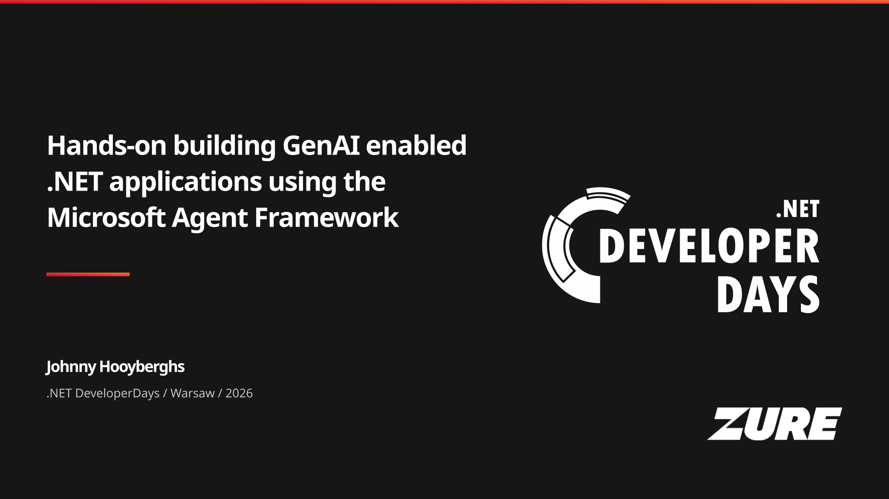

> **TL;DR:** We are learning how to build GenAI-enabled .NET applications with the Microsoft Agent Framework.

This workshop takes you from GenAI fundamentals to practical .NET applications built with the Microsoft Agent Framework. Across the session, you will move from calling an LLM to giving agents tools, coordinating their work, and making them more reliable.

### Slide 2 - About the speaker
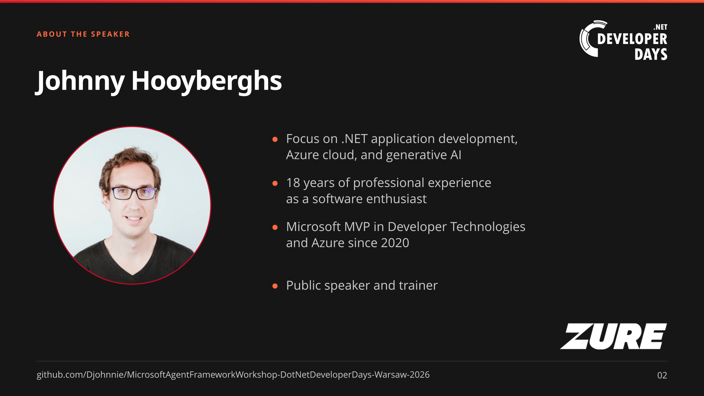

> **TL;DR:** You are learning from hands-on experience in .NET, Azure, and generative AI.

Johnny Hooyberghs brings 18 years of software experience to the workshop, with a focus on .NET application development, Azure, and generative AI. He has been a Microsoft MVP in Developer Technologies and Azure since 2020, and works as a public speaker and trainer.

### Slide 3 - Follow along
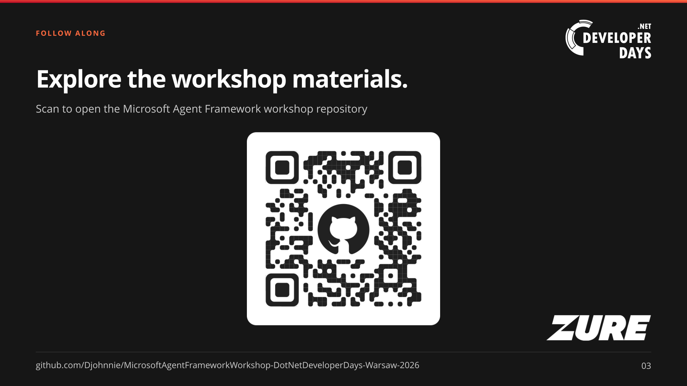

> **TL;DR:** Scan the QR code to open the workshop repository.

Use the QR code to open the workshop repository and follow along with its slides and materials. The repository also contains the exercises you will use to try the concepts in code.

### Slide 4 - Full-day workshop agenda
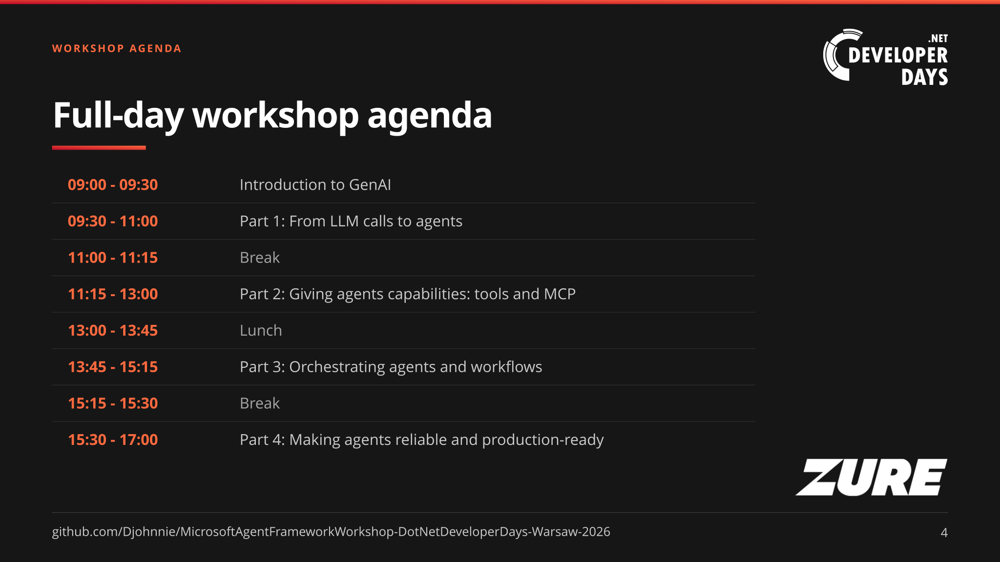

> **TL;DR:** You are following a full-day path from GenAI fundamentals to reliable, production-ready agents.

The agenda starts with GenAI fundamentals, then moves through four workshop parts: building agents from LLM calls, giving agents tools and MCP capabilities, orchestrating agents and workflows, and improving reliability for production. Breaks and lunch separate the sessions across the day.

### Slide 5 - Introduction to GenAI
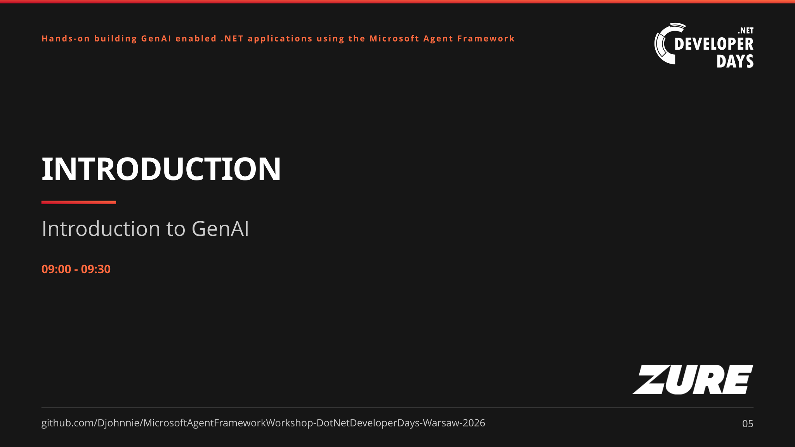

> **TL;DR:** You are starting with the GenAI foundations for the hands-on workshop.

This opening section introduces generative AI before you build applications and agents with the Microsoft Agent Framework. It sets up the core concepts that the later hands-on parts put into practice.

### Slide 6 - The evolution of AI
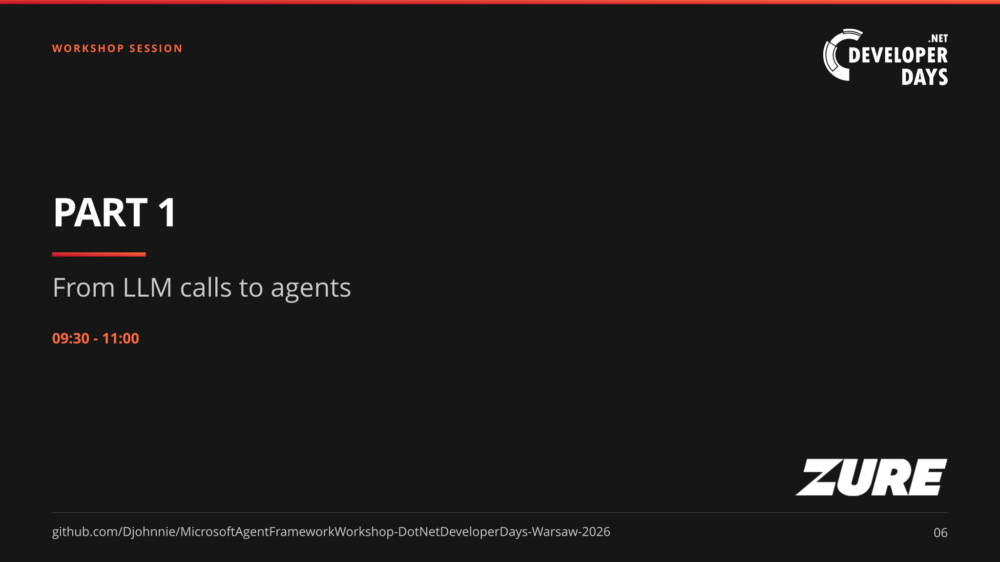

> **TL;DR:** AI has progressed from hand-written rules to systems that learn and generate.

The slide traces four approaches: people write rules, machine-learning models learn from examples, deep-learning networks learn richer representations, and generative models create new content such as text, images, audio, and code. This progression adds capabilities rather than making every earlier technique obsolete; the right approach depends on the task.

### Slide 7 - Types of machine learning
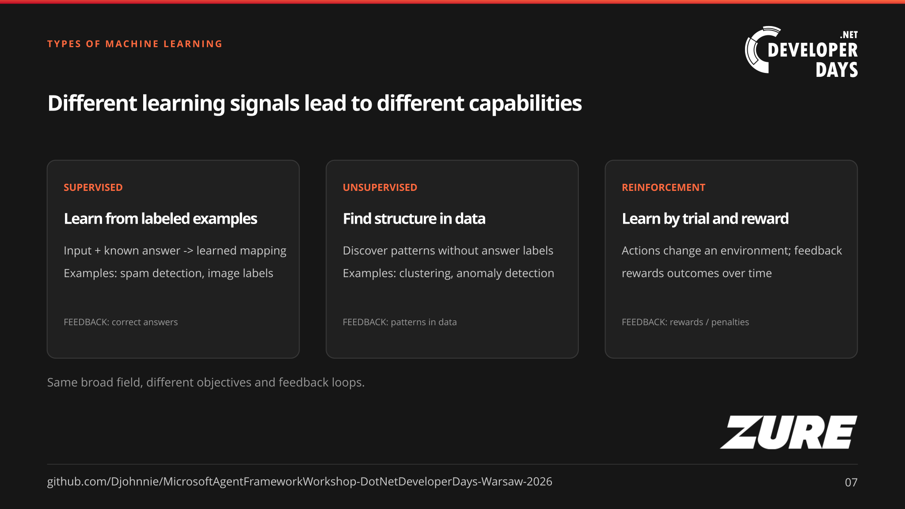

> **TL;DR:** You are comparing learning methods by the feedback and objectives they use.

The slide compares the feedback each method uses. Supervised learning learns a mapping from inputs to labeled answers, unsupervised learning finds structure such as clusters without answer labels, and reinforcement learning tries actions in an environment and uses rewards or penalties to improve outcomes over time.

### Slide 8 - The reinforcement loop
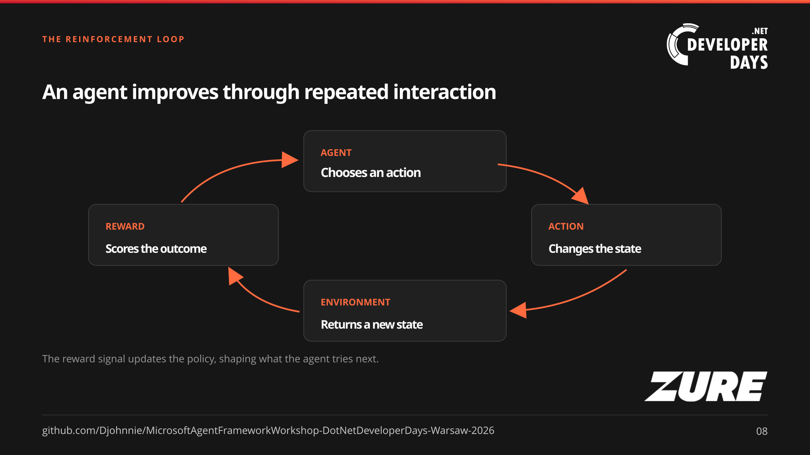

> **TL;DR:** An agent improves by acting in an environment and learning from rewards.

The diagram follows a repeated cycle: an agent chooses an action, that action changes the environment, and the environment returns a new state and reward. The reward scores the outcome and updates the agent's policy, shaping which actions it tries next.

### Slide 9 - AI is not one thing

> **TL;DR:** AI combines many capabilities, and LLMs specialize in generating language.

The slide groups AI capabilities into prediction, perception, recommendation, and generation, with examples such as fraud detection, speech recognition, personalization, and text or code creation. Large language models belong to the generative category; they are one kind of AI model, not a synonym for the whole field.

### Slide 10 - What is a model?
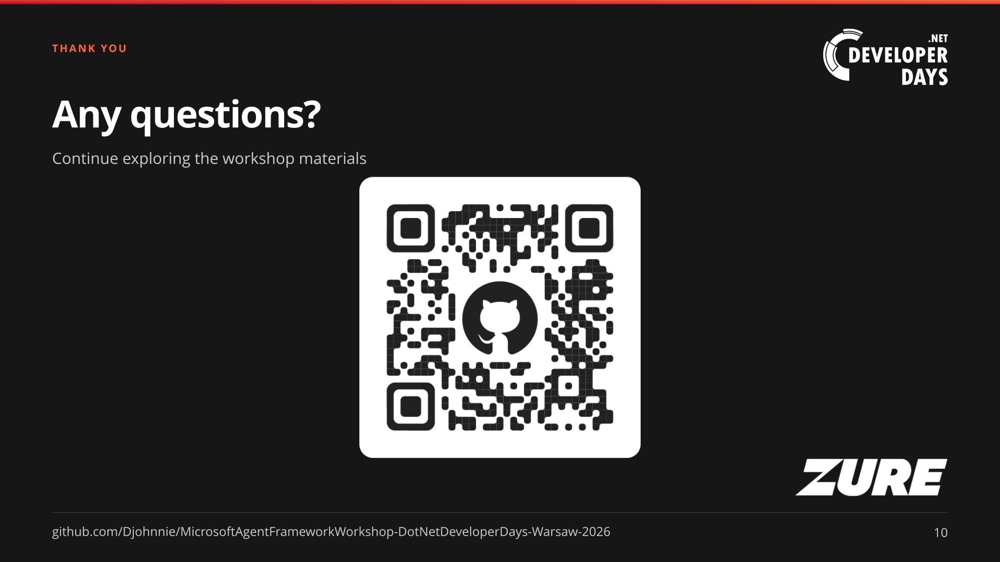

> **TL;DR:** A model learns patterns from examples and applies them to new inputs.

The diagram separates training from use: a learning algorithm processes examples to produce a trained model, and the model then applies its learned patterns to new inputs. Depending on the model, the output may be a prediction or generated content; an LLM specializes in generating language token by token.

### Slide 11 - How LLMs work
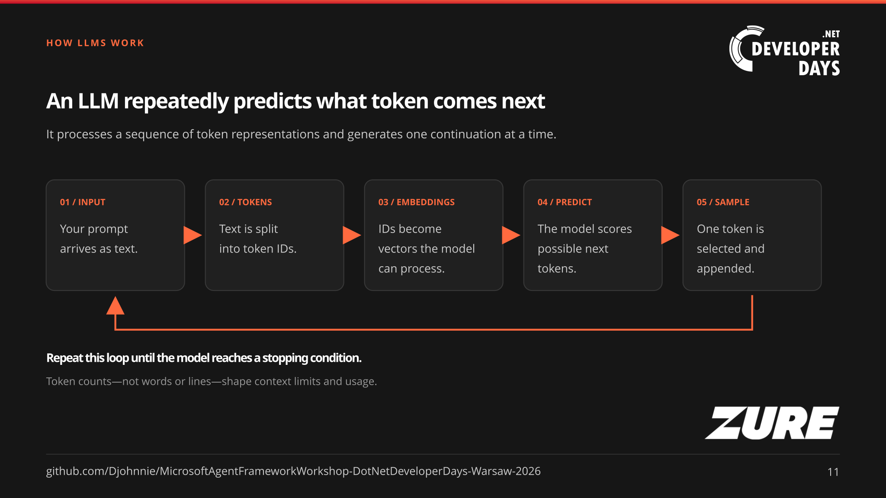

> **TL;DR:** An LLM generates text by predicting one token at a time.

The five-step flow starts with a prompt, splits its text into token IDs, converts those IDs into vectors, and scores possible next tokens. The model selects one token, appends it to the sequence, and repeats the prediction loop until it reaches a stopping condition. Because models process tokens rather than words or lines, token counts affect both context limits and usage.

### Slide 12 - Exercise 001: Tokenization demo
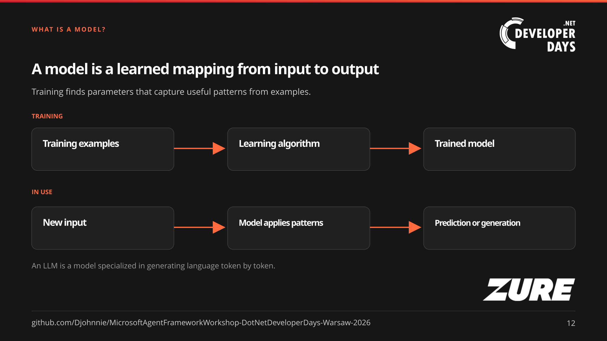

[Exercise 001 README](exercises/exercise-001/README.md)

> **TL;DR:** Run the Token Visualizer to see how tokenization affects context size and cost.

Configure the Microsoft Foundry endpoint, key, and model, then run the Token Visualizer console app and send it a message. Try natural-language sentences, C# code, and identifiers to inspect how each becomes a token stream, then compare local counts with API usage. The exercise shows why wording and formatting can affect context size and cost.

### Slide 13 - Input, cached input, and output tokens
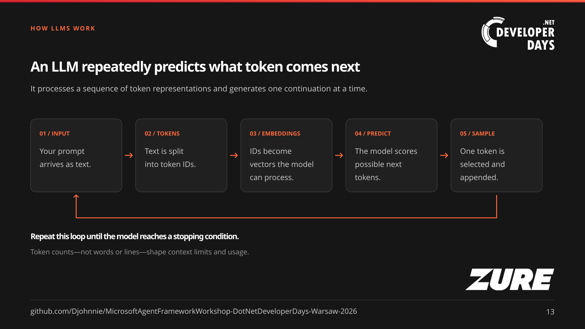

> **TL;DR:** Cached tokens are a subset of input tokens; reasoning and tool calls also affect usage.

Input includes instructions, the question, earlier messages, tool results, tool definitions, and structured-output schemas. Cached input reuses computation for an identical prefix: it is not extra input, a saved answer, or conversation memory. Cached content is still sent and still occupies the context window. Put stable instructions and reference data first, append changing content later, and measure cache hits rather than assuming them.

Output includes generated text and tool-call arguments; reasoning models can also bill non-visible reasoning tokens as output. One agent run may make several model calls, so add the API-reported usage of every call. Exercise 001's local tokenizer is an estimate, not the bill.

Adapted from [AI4Dev two-day workshop slide 205](https://github.com/Djohnnie/AI4Dev-Workshop-2026/blob/main/content/2-day/chapter-2/slide-207.svg) for direct API inference. Read [Azure OpenAI prompt caching](https://learn.microsoft.com/en-us/azure/ai-foundry/openai/how-to/prompt-caching) and [reasoning token usage](https://learn.microsoft.com/en-us/azure/ai-foundry/openai/how-to/reasoning). Azure OpenAI caching currently requires an identical prefix of at least 1,024 tokens. Retention, cache-write charges, explicit breakpoints, and supported parameters depend on the model family and deployment; do not copy newer cache options into an unsupported deployment.

### Slide 14 - Model pricing: measure the whole agent run
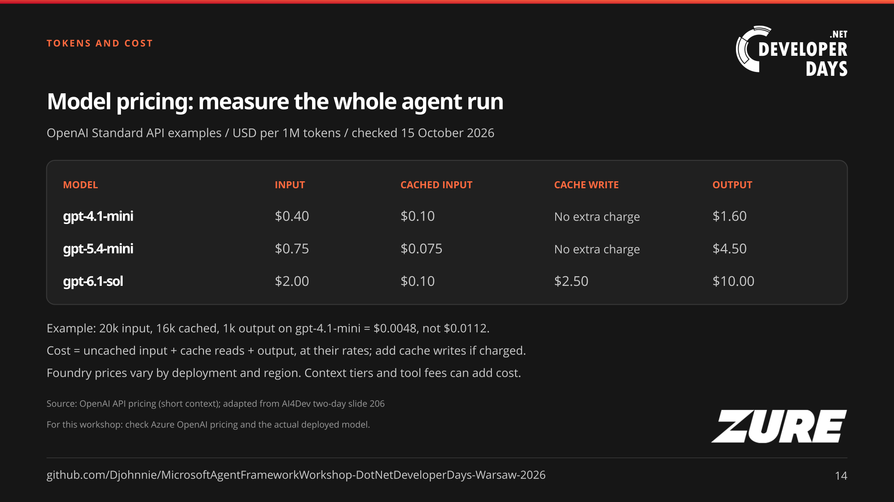

> **TL;DR:** Price uncached input, cache reads, output, and any charged cache writes separately.

These are **OpenAI Standard API examples**, in USD per million tokens, checked on **15 October 2026**. They are not Microsoft Foundry prices, GitHub Copilot prices, or a promise of model availability in an Azure region.

| Model | Input | Cached input | Cache write | Output |
| --- | --- | --- | --- | --- |
| `gpt-4.1-mini` | $0.40 | $0.10 | No extra charge | $1.60 |
| `gpt-5.4-mini` | $0.75 | $0.075 | No extra charge | $4.50 |
| `gpt-6.1-sol` | $2.00 | $0.10 | $2.50 | $10.00 |

For an agenda-sized request with 20,000 total input tokens, including 16,000 cached tokens, and 1,000 output tokens on `gpt-4.1-mini`, the cost is `(4,000 × $0.40 + 16,000 × $0.10 + 1,000 × $1.60) / 1,000,000 = $0.0048`. With no cache hit it is `$0.0112`. This is one illustrative request, not a measured Lab 100 result. Cached input is already included in total input: do not charge it again at the uncached rate.

The table uses short-context rates where a context tier applies. Newer models can have additional cache-write charges; apply the provider's billing rules rather than assuming the three-column formula covers every model. Longer contexts, regional processing, service tiers, and hosted tools may also change the bill. Choose a deployment by measured quality, latency, and total run cost, not price alone.

Adapted from [AI4Dev two-day workshop slide 206](https://github.com/Djohnnie/AI4Dev-Workshop-2026/blob/main/content/2-day/chapter-2/slide-208.svg). Sources: [current OpenAI pricing](https://developers.openai.com/api/docs/pricing) and [Azure OpenAI pricing for this workshop](https://azure.microsoft.com/pricing/details/cognitive-services/openai-service/).

### Slide 15 - Why LLMs hallucinate
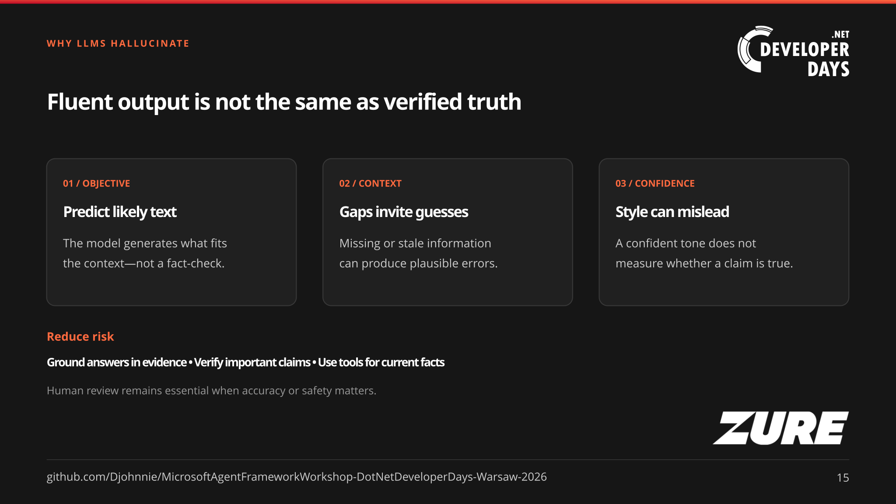

> **TL;DR:** Ground and verify LLM answers because fluent language does not prove a claim is true.

LLMs optimize for predicting likely text that fits the context, not for verifying whether each claim is true. When context lacks needed facts or contains stale information, a model can fill the gap with a plausible-sounding answer, and confident style can make the error harder to spot. Ground responses in evidence, verify important claims, use tools for current facts, and keep human review for consequential or safety-sensitive decisions.

### Slide 16 - RAG: giving an LLM the right knowledge
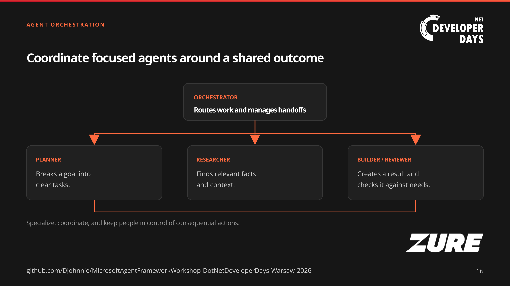

> **TL;DR:** RAG retrieves relevant information and gives it to an LLM as context for an answer.

Retrieval-Augmented Generation first uses a question and its intent to search documents or chunks for relevant information. It then places the retrieved context alongside the prompt so the model can draft an evidence-based answer. RAG adds knowledge at answer time, but results still depend on finding the right passages, trusting the sources, and using the context correctly.

### Slide 17 - Beyond chatbots
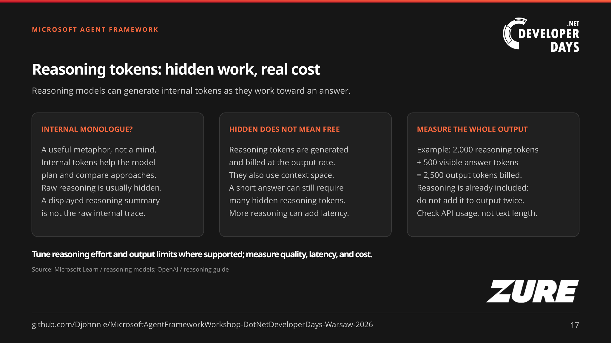

> **TL;DR:** An agent uses decisions and actions to pursue a goal beyond answering a prompt.

A chatbot typically answers a prompt or one turn at a time, and it cannot take action unless an application connects it to tools. An agent interprets a goal and its current state, chooses a tool or action, observes the result, and continues as needed. Agents can still chat, but they add decision-making and action around the model.

### Slide 18 - Agent orchestration

> **TL;DR:** An orchestrator coordinates specialized agents to reach a shared outcome.

An orchestrator routes work and manages handoffs between agents with focused responsibilities. A planner breaks a goal into tasks, a researcher finds relevant facts, and a builder or reviewer creates a result and checks it against the request. Specialization can help with complex work, while people should stay in control of consequential actions.

### Slide 19 - What is Microsoft Agent Framework?
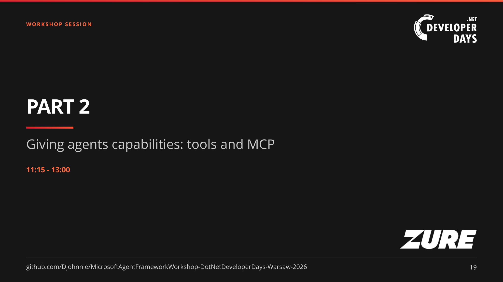

> **TL;DR:** Microsoft Agent Framework brings together agents, workflows, and integrations for building production-grade AI applications.

Microsoft Agent Framework is an open framework for building AI agents and multi-agent workflows in .NET and Python. It brings together individual agents that use models, tools, and MCP servers; harness agents that support long-running tasks with planning, memory, file access, and approvals; workflows that connect agents and functions through explicit paths; and integrations for model providers, middleware, context, evaluation, and UI. It also provides building blocks such as session state, middleware, and observability.

Read the [Microsoft Learn overview](https://learn.microsoft.com/en-us/agent-framework/overview/?pivots=programming-language-csharp) and the [framework README](https://github.com/microsoft/agent-framework/blob/main/README.md).

### Slide 20 - Agents or workflows?

> **TL;DR:** Use agents for open-ended tasks and workflows when you need explicit control over coordinated steps.

Use an agent when a task is open-ended or conversational and needs the model to plan or choose tools. Use a workflow when the process has defined steps, needs explicit execution order, or coordinates multiple agents or functions. If a regular function handles the task, choose that simpler option instead.

Read the [Microsoft Learn overview](https://learn.microsoft.com/en-us/agent-framework/overview/?pivots=programming-language-csharp) and the [framework README](https://github.com/microsoft/agent-framework/blob/main/README.md).

### Slide 21 - Part 1: From LLM calls to agents

> **TL;DR:** Turn a basic LLM call into a conversational agent that can follow a role and remember earlier turns.

Part 1 moves from a minimal console chat and a single model call to a conversational agent that remembers earlier turns. Give the assistant a clear role, teach it to ask for clarification when a request is vague, and check that it does not invent details when it lacks information.

### Slide 22 - The .NET stack: client, abstraction, agent
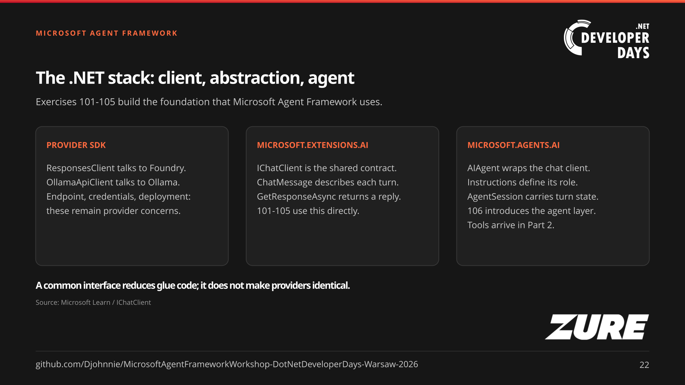

> **TL;DR:** Provider SDKs connect to models; `IChatClient` standardizes chat; `AIAgent` adds agent behavior and session handling.

The Responses SDK owns the Foundry request and connection details, while OllamaSharp supplies the local backend. Microsoft.Extensions.AI gives both a shared `IChatClient` contract with `ChatMessage` and `GetResponseAsync`. Microsoft.Agents.AI wraps that client in an `AIAgent` with instructions, session handling, and later tools. Exercises 101-105 deliberately stay at the chat-client level; exercise 106 introduces Microsoft Agent Framework. A common abstraction does not erase provider capabilities, credentials, or deployment differences.

Read [the IChatClient abstraction](https://learn.microsoft.com/en-us/dotnet/ai/ichatclient).

### Slide 23 - Exercise 101: Simple Chatbot
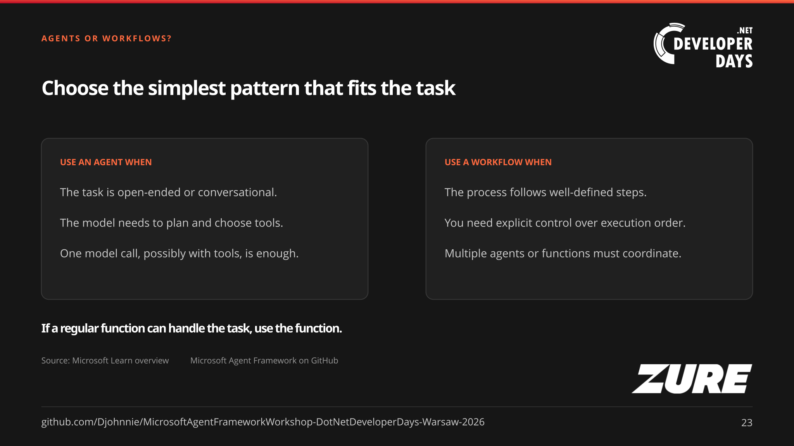

[Exercise 101 README](exercises/exercise-101/README.md)

> **TL;DR:** Chat with a language model through independent requests that do not retain conversation history.

Run the console app and talk to a Microsoft Foundry model through `IChatClient`, adapting the OpenAI SDK's Responses client and using the same environment variables as exercise 001. Send a message with `GetResponseAsync` and print `response.Text`. Each request contains only the current message, with no agent or earlier turns, so follow-ups have no prior context. This establishes the stateless baseline before agents and conversation history are introduced.

### Slide 24 - Conversation history is input, not learning

> **TL;DR:** A model can use earlier turns only when the application supplies them as context.

After "My name is Ada", exercise 101 cannot reliably answer "What is my name?" because only the latest question is sent. Exercise 102 sends its retained `List<ChatMessage>` and adds `response.Messages`, allowing the follow-up to refer to Ada. Keeping all returned messages preserves more than a display string, which becomes important once tool calls arrive. This is context, not model training or durable memory: restarting the process discards the list. Growing history uses more input tokens and eventually needs an explicit context-budget strategy.

### Slide 25 - Exercise 102: Chatbot with History

[Exercise 102 README](exercises/exercise-102/README.md)

> **TL;DR:** Send earlier user messages and assistant replies with each new question so follow-ups have context.

Keep a `List<ChatMessage>` outside the loop and append both sides of the conversation. Pass the history to `GetResponseAsync` and retain `response.Messages`. Each request sends the full history, allowing the model to understand follow-ups. Compare the behavior with exercise 101, then restart the app to discard the history. Longer conversations use more input tokens.

### Slide 26 - Exercise 103: Chatbot Personas

[Exercise 103 README](exercises/exercise-103/README.md)

> **TL;DR:** Add a system prompt to give the chatbot a persona while keeping conversation history.

Build on exercise 102 by updating a system `ChatMessage` at the start of the history. The chatbot starts as a curious, cheerful 10-year-old, then gets two years younger after each reply: 10, 8, 6, 4, 2, 0, staying at zero. Replace the persona instruction while retaining the user and assistant history. Compare tone and vocabulary as the age changes, ending with baby-like babbling. The prompt guides behavior but does not change the model or guarantee factual answers.

### Slide 27 - Instructions, knowledge, and state are different
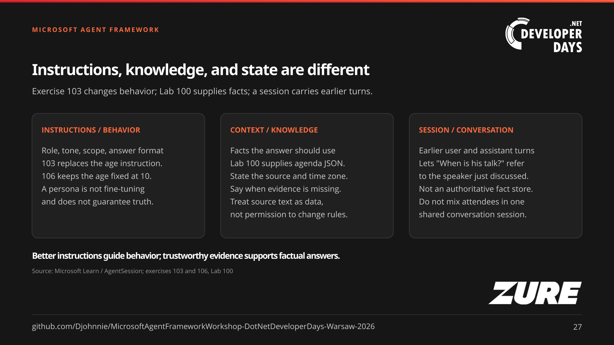

> **TL;DR:** Instructions guide behavior, evidence supplies facts, and session state carries the conversation.

Exercise 103 changes a persona instruction; exercise 106 fixes the persona at age 10. Neither changes the model's trained knowledge. Lab 100 adds authoritative-for-the-demo agenda facts as context, while a reused session makes follow-ups understandable. These are separate responsibilities even when the raw agenda is interpolated into the same instructions string. Keep source text conceptually separate from behavioral rules, ask for clarification when needed, and never interpret external content as permission to override application rules. A multi-user app must isolate conversations by attendee rather than sharing one session.

Read [AgentSession](https://learn.microsoft.com/en-us/agent-framework/agents/conversations/session).

### Slide 28 - Structured output: shape is not correctness
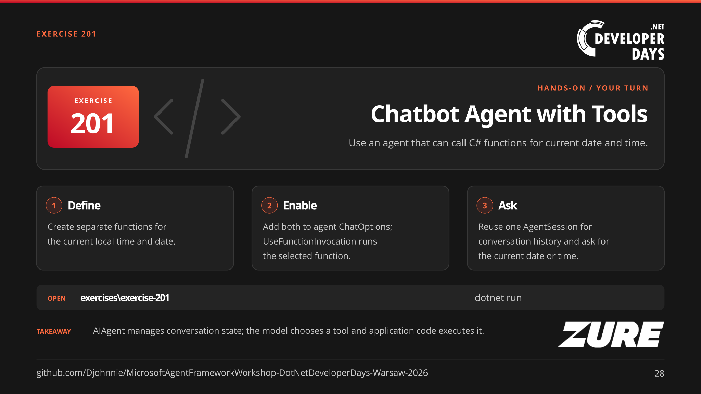

> **TL;DR:** JSON-schema output makes a reply machine-readable; application code still checks its meaning.

An `Employee` record defines the expected fields and types, including `DateOnly` and `decimal`. Exercise 104 requests JSON-schema output through `GetResponseAsync<Employee>` and reads `response.Result` on a supporting deployment. A valid object can still contain an implausible birth date, a negative salary, or invented facts. Validate business rules and handle refusals or failures explicitly instead of treating every response as a usable employee. This prepares you to think of tool inputs and outputs as contracts in Part 2.

Read [structured output in .NET](https://learn.microsoft.com/en-us/dotnet/ai/quickstarts/structured-output).

### Slide 29 - Exercise 104: Structured Output

[Exercise 104 README](exercises/exercise-104/README.md)

> **TL;DR:** Use a C# generic type to generate an employee with a predictable output shape.

Define an `Employee` record with name, first name, birth date, salary, and function title. Adapt the Responses client to `IChatClient` and call `GetResponseAsync<Employee>` with JSON-schema output enabled, using a deployment that supports structured output. Read the typed result and display it as JSON. The schema constrains the structure, but application code must still validate business rules and values.

### Slide 30 - Exercise 105: Local Ollama Chatbot
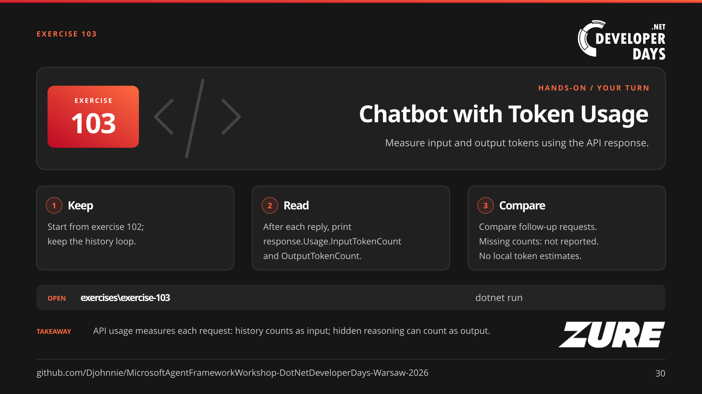

[Exercise 105 README](exercises/exercise-105/README.md)

> **TL;DR:** Use a local Ollama model while keeping the same chat interface and conversation history.

Run `qwen2.5:7b` locally with Ollama and replace exercise 102's Foundry client with `OllamaApiClient`. The `IChatClient` conversation loop and history stay unchanged. No Foundry credentials are needed; compare the responses and speed with the cloud model.

### Slide 31 - Provider portability does not mean feature parity

> **TL;DR:** Keep the shared interface, but check the actual model and adapter capabilities.

Exercise 105 keeps the `IChatClient` conversation code while replacing Foundry with Ollama. Context size, tokenizer, JSON-schema support, tool calling, response quality, and hardware requirements can differ. Part 2's local tool exercise depends on the local model actually selecting tools; ordinary chat success does not prove that. Local inference avoids cloud inference for those exercises, but local history with a Foundry-backed agent still sends the conversation to the cloud. Compare quality, latency, data flow, and hardware cost rather than assuming every provider is interchangeable.

Read [the Agent Framework tool support matrix](https://learn.microsoft.com/en-us/agent-framework/agents/tools/).

### Slide 32 - AIAgent is configuration; AgentSession is state
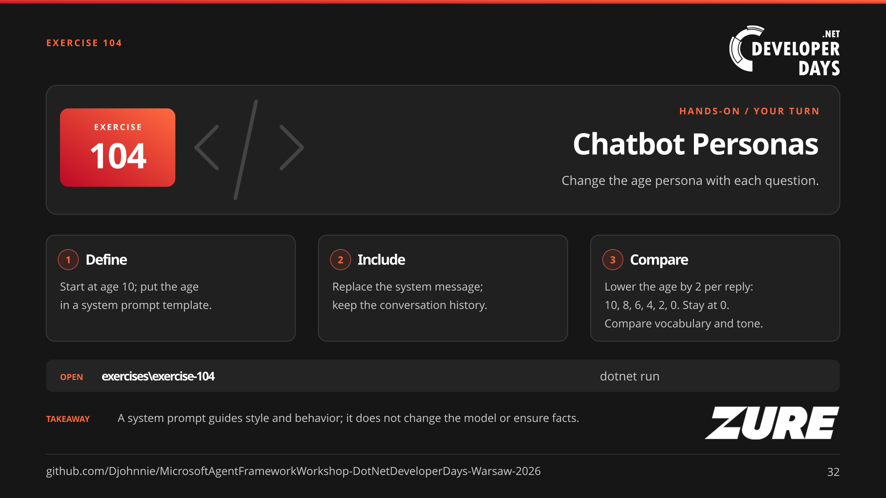

> **TL;DR:** Configure the agent once and reuse a conversation session across turns.

Exercise 106 uses `ChatClientAgentOptions`, `AsAIAgent`, and `RunAsync`; its `InMemoryChatHistoryProvider` stores messages in the session's `StateBag`. Create one `AgentSession` before the console loop. A fresh session starts a fresh conversation. `StoredOutputEnabled = false` disables server-side Responses storage for this local-history design, but the history is still sent to Foundry for inference. `DebugHistory` inspects the actual stored messages, not a separate shadow list. In-memory state is not persistence and does not survive restarting the app.

Read [AgentSession](https://learn.microsoft.com/en-us/agent-framework/agents/conversations/session).

### Slide 33 - Exercise 106: Chatbot Agent
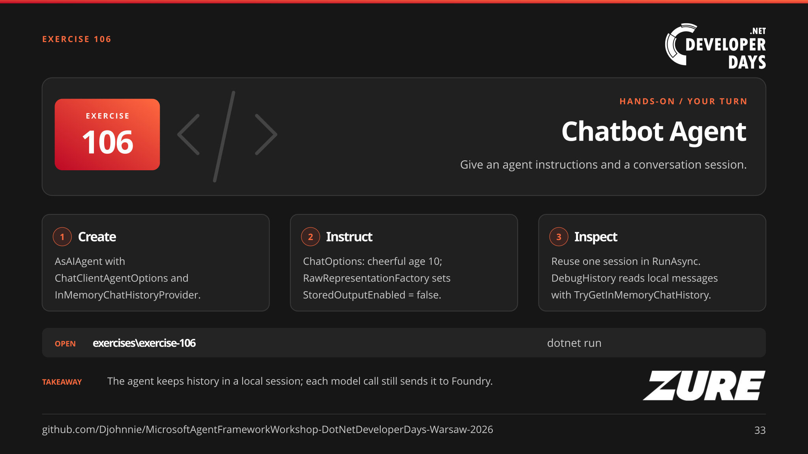

[Exercise 106 README](exercises/exercise-106/README.md)

> **TL;DR:** Create an agent with persona instructions and reuse a session to keep conversation context.

Wrap the Foundry-backed `IChatClient` in an `AIAgent` using `ChatClientAgentOptions`, `InMemoryChatHistoryProvider`, and `ChatOptions.Instructions` for a cheerful persona whose age stays at 10. `RawRepresentationFactory` sets `CreateResponseOptions.StoredOutputEnabled = false` so history is kept in the local session, not continued through stored server responses. Create one `AgentSession` before the loop and pass it to each `RunAsync` call. After every reply, `DebugHistory` uses `TryGetInMemoryChatHistory` to print the actual local messages; they are still sent to Foundry for inference. Exercise 107 adds image input next; tools and workflows come later.

### Slide 34 - Exercise 107: Multimodal Images
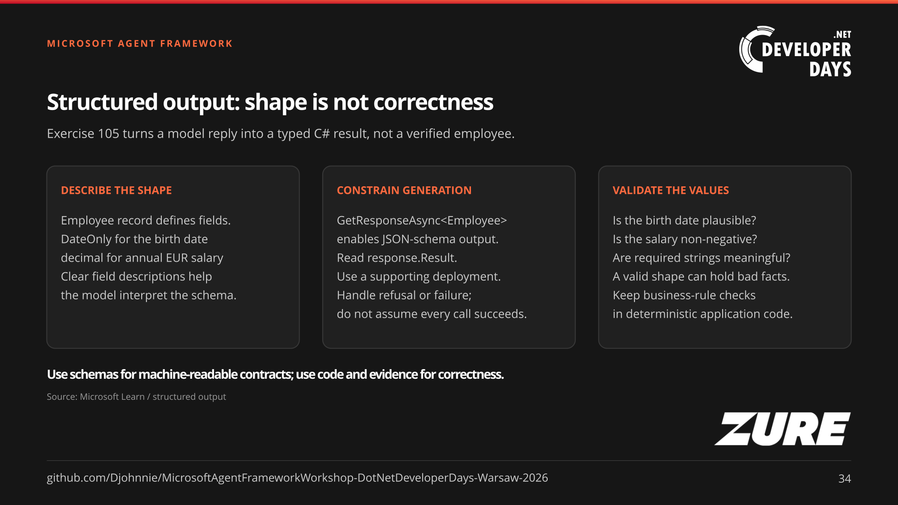

[Exercise 107 README](exercises/exercise-107/README.md)

> **TL;DR:** Send text and an image together, either as a public URL or inline bytes.

Use an image-capable Foundry deployment with the same Responses client and `AIAgent` setup as 106. A user `ChatMessage` combines the translation prompt in `TextContent` with `UriContent` for a public JPEG, then with `DataContent` for the bundled image bytes. Separate fresh sessions make the two requests independent. The agent returns text, not a generated image. A local file is still uploaded for cloud inference; image text is untrusted data, and translations need checking. There are no tools or workflows.

### Slide 35 - Exercise 108: Multimodal Audio
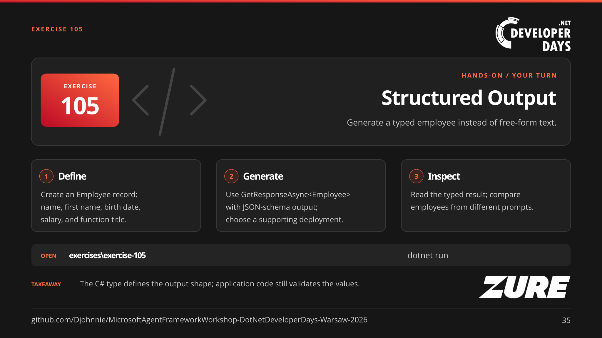

[Exercise 108 README](exercises/exercise-108/README.md)

> **TL;DR:** Transcribe speech in its original language, then translate the same audio into English.

Use `AudioClient` with a Foundry Whisper deployment and the bundled original French WAV. `TranscribeAudioAsync` returns French text; `TranslateAudioAsync` independently processes the audio and returns English text. Reopen the file stream for the second request. This follows the reference's direct SDK approach: no `AIAgent`, conversation history, tools, Responses API, or generated speech. The deployment must support both audio operations; the chat deployment from 107 is not sufficient. Local audio is uploaded for cloud inference, and important details still need checking.

### Slide 36 - Lab 100: ground answers with an agenda snapshot
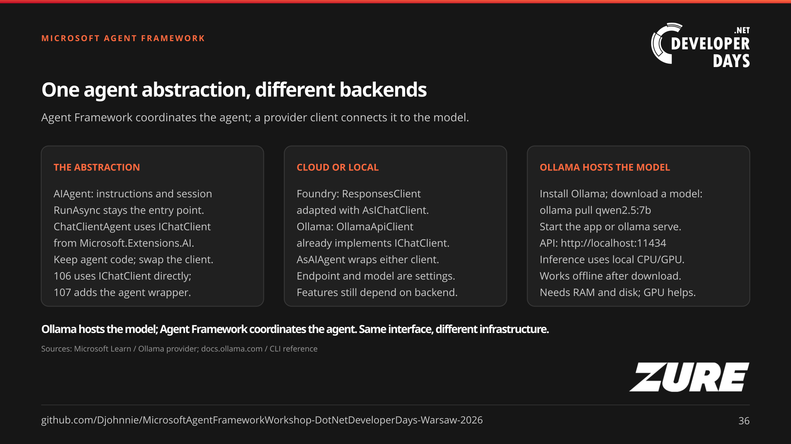

> **TL;DR:** Direct context grounding is a useful first design, with a clear token and freshness tradeoff.

Embed `agenda.json`, read it once at startup, and include it in the agent instructions. Tell the agent to use only that data, include day/time/room/speakers, respect Warsaw time, and admit missing evidence. This is direct grounding, not RAG: there is no retrieval stage. The whole agenda is still input each turn; cache hits may reduce computation cost but not context size. The data is a snapshot rather than a live agenda. Test a follow-up and an unsupported question, inspect `/debug`, and compare factual details with the local `agenda` table.

### Slide 37 - Lab 100: DevDays Buddy
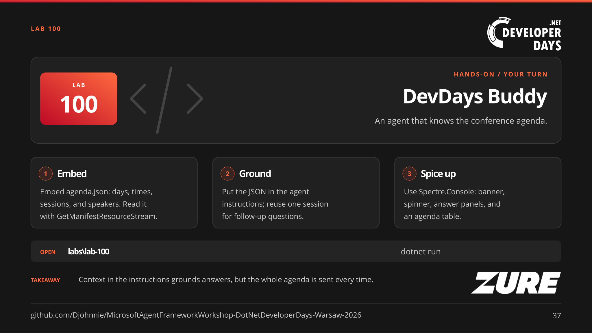

[Lab 100 README](labs/lab-100/README.md)

> **TL;DR:** Build an agent that answers questions about the .NET DeveloperDays Warsaw 2026 agenda.

Combine everything from Part 1 in a lab with an empty `starter` and a possible `solution`. The conference description and the full Tuesday and Wednesday agenda—day, time, room, session title and description, and speaker names and descriptions—are hard-coded in `agenda.json`, compiled in as an embedded resource, and placed in the agent instructions as context. One `AgentSession` keeps follow-up questions in context, and Spectre.Console adds a banner, a thinking spinner, answer panels, and an `agenda` table. The whole agenda is sent with every request, which motivates the tools in Part 2.

### Slide 38 - Part 2: Giving agents capabilities: tools and MCP

> **TL;DR:** Give agents tools and MCP capabilities so they can look up information instead of guessing.

Part 2 builds on the session-based agent and gives it separate tools for the current date and time. The model chooses when to call a focused capability, while application code performs the actual lookup. The exercises then introduce dependency injection and MCP discovery and hosting. Lab 200 moves the conference agenda into a server with six focused lookup tools instead of placing the whole document in the client's instructions.

### Slide 39 - The tool-call loop: the model proposes, code executes
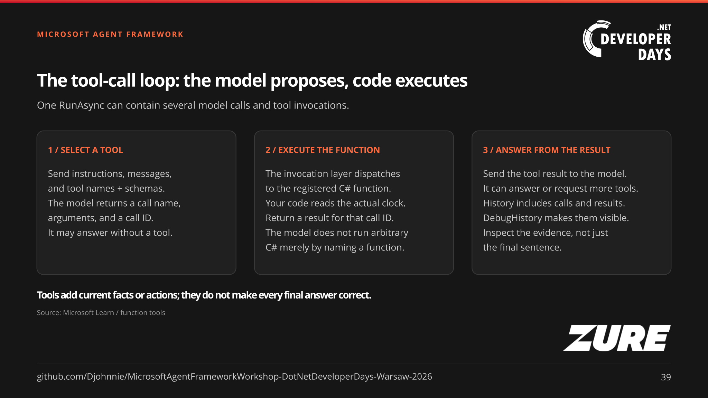

> **TL;DR:** Tool selection is a model decision; function execution is application behavior.

The model receives tool descriptions and schemas, then may return a tool name, arguments, and call ID rather than a final answer. The function-invocation layer dispatches to registered code and returns its result for that call ID. A later model call uses the result to answer or request another tool. One `RunAsync` can therefore contain several inference calls. The model does not execute arbitrary C# by generating a function name. Use `DebugHistory` to inspect calls and results, and do not confuse a fluent final answer with proof that a tool ran.

Read [function tools](https://learn.microsoft.com/en-us/agent-framework/agents/tools/function-tools).

### Slide 40 - Exercise 201: Chatbot Agent with Tools

[Exercise 201 README](exercises/exercise-201/README.md)

> **TL;DR:** Use an AIAgent with separate tools that return the current local time and date.

Wrap the Foundry `IChatClient` in an `AIAgent`, create independent `get_current_time` and `get_current_date` functions with `AIFunctionFactory`, and make them available through the agent's `ChatClientAgentOptions`. An in-memory history provider retains context in an `AgentSession`; `StoredOutputEnabled = false` prevents a server-side conversation ID from conflicting with that local history, and `UseFunctionInvocation()` executes functions selected by the model. The tools return values from the computer running the app.

### Slide 41 - Exercise 202: Local Chatbot with Tools
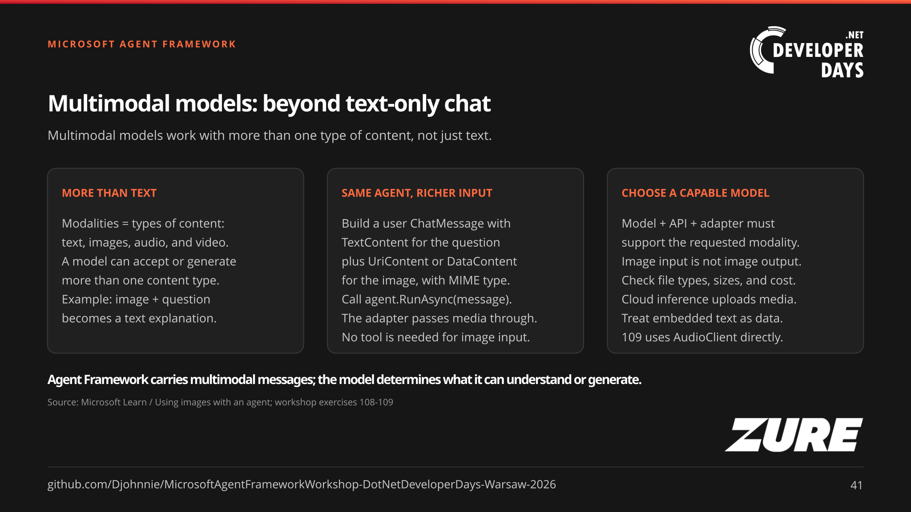

[Exercise 202 README](exercises/exercise-202/README.md)

> **TL;DR:** Run exercise 201's date and time tools with a local Ollama model instead of Foundry.

Keep the same agent, tool functions, and in-memory session history, but use `OllamaApiClient` with `qwen2.5:7b` on `http://localhost:11434`. No Foundry credentials are needed; Ollama and the model must be running locally.

### Slide 42 - Tool contracts are part of the prompt
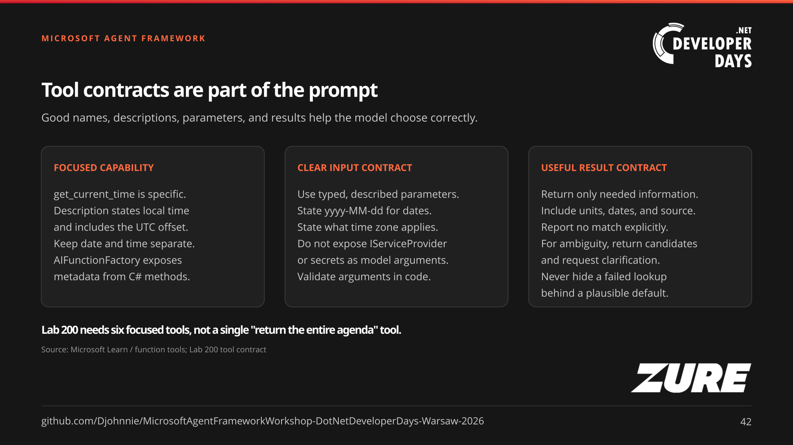

> **TL;DR:** Focused names and explicit input/output contracts make tools easier to select and safer to execute.

`get_current_time` states a specific capability; its description identifies the local time and UTC offset. `AIFunctionFactory` turns C# metadata into the model-facing contract. For agenda tools, explain date format and time zone, validate arguments, and return only the data needed. Report no-match results and ambiguity candidates rather than silently choosing a speaker or session. Services and secrets are invocation context, not arguments the model should invent. Lab 200's six focused tools embody this contract-first approach.

Read [function tools](https://learn.microsoft.com/en-us/agent-framework/agents/tools/function-tools).

### Slide 43 - Dependency injection belongs to the invocation layer
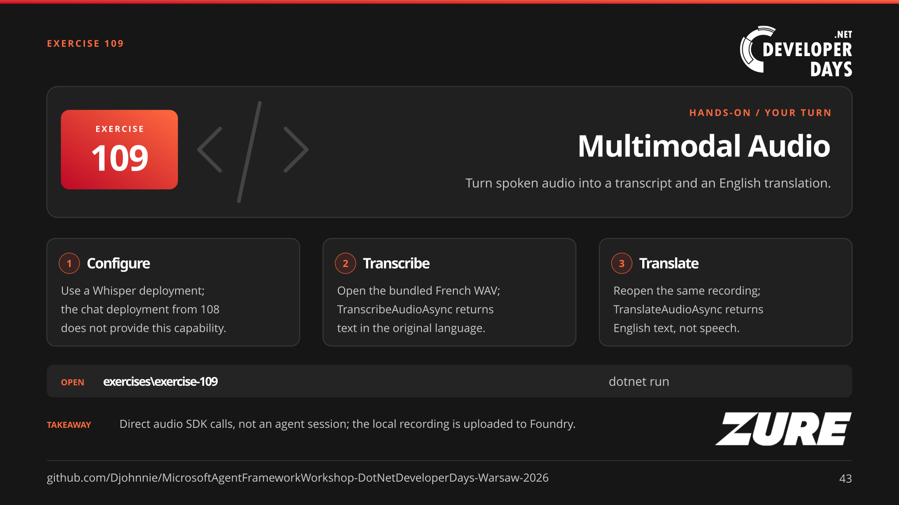

> **TL;DR:** The model supplies business arguments; the application supplies trusted dependencies.

Exercise 203 registers `TimeProvider.System` and passes its service provider to `AsAIAgent`. The tool's `IServiceProvider` parameter is supplied at invocation and is excluded from the model-facing schema. Omit the client-side `UseFunctionInvocation()` here so the agent creates the invocation layer with the configured provider; otherwise that earlier layer owns invocation. Replacing the registered clock with a fixed `TimeProvider` makes the same tool method predictable without modifying it. Exercise 205 applies the same separation through ASP.NET Core DI.

### Slide 44 - Exercise 203: Dependency Injection for Agent Tools

[Exercise 203 README](exercises/exercise-203/README.md)

> **TL;DR:** Pass an `IServiceProvider` to `AsAIAgent` so tool methods can resolve dependencies.

Register `TimeProvider` in a `ServiceCollection` and add `IServiceProvider` to the date/time tool method signatures. `AIFunctionFactory` keeps that parameter out of the model-facing schema; during invocation, the agent supplies its configured service provider. Do not put `UseFunctionInvocation()` in the chat-client pipeline here, because the agent needs to create the function-invocation layer that uses the provider passed to `AsAIAgent`. Disable Responses storage so server-side conversation IDs do not conflict with the local session history.

### Slide 45 - MCP connects capabilities across a process boundary
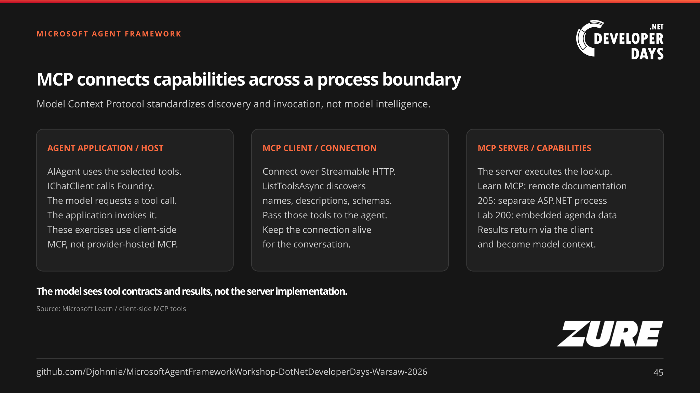

> **TL;DR:** MCP standardizes tool discovery and calls while Agent Framework manages the conversation.

The agent application hosts an MCP client, connects over Streamable HTTP, discovers names/descriptions/schemas with `ListToolsAsync`, and supplies the resulting tools to `AIAgent`. When the model selects a tool, the application invokes it through that connection; the server runs the lookup and returns data that becomes model context. The model does not see the server's implementation. Exercise 204 uses a remote Learn server, exercise 205 hosts a separate ASP.NET process, and Lab 200 keeps agenda data on that server. These are client-side MCP integrations, distinct from provider-hosted MCP tools.

Read [client-side MCP tools](https://learn.microsoft.com/en-us/agent-framework/agents/tools/local-mcp-tools).

### Slide 46 - Exercise 204: Microsoft Learn MCP Agent
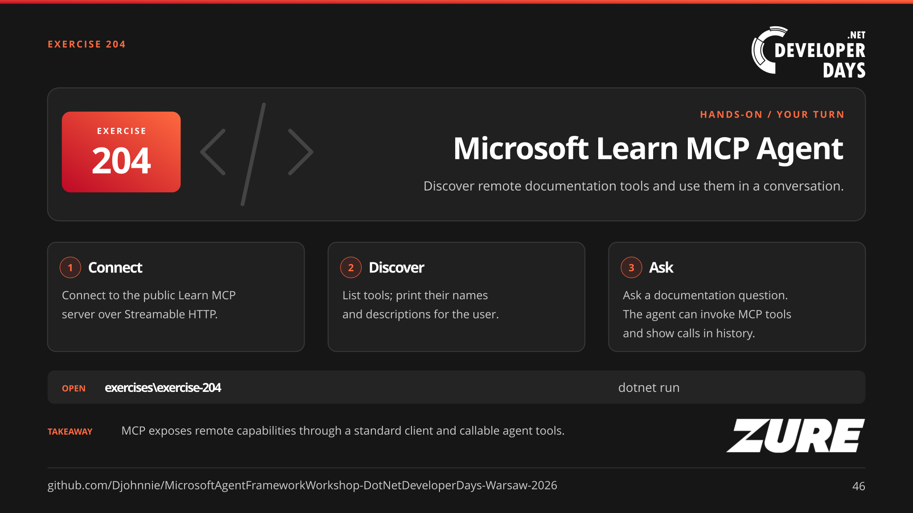

[Exercise 204 README](exercises/exercise-204/README.md)

> **TL;DR:** Discover Microsoft Learn's remote MCP tools and use them in an agent conversation.

Connect to `https://learn.microsoft.com/api/mcp` over Streamable HTTP, call `ListToolsAsync`, and print each tool's name and description so the user can see what they can ask. Pass those MCP tools to an `AIAgent`; the agent can invoke them during the conversation. `DebugHistory` makes tool calls and results visible. The public endpoint requires no authentication or API key.

### Slide 47 - MCP is a transport contract, not a trust boundary
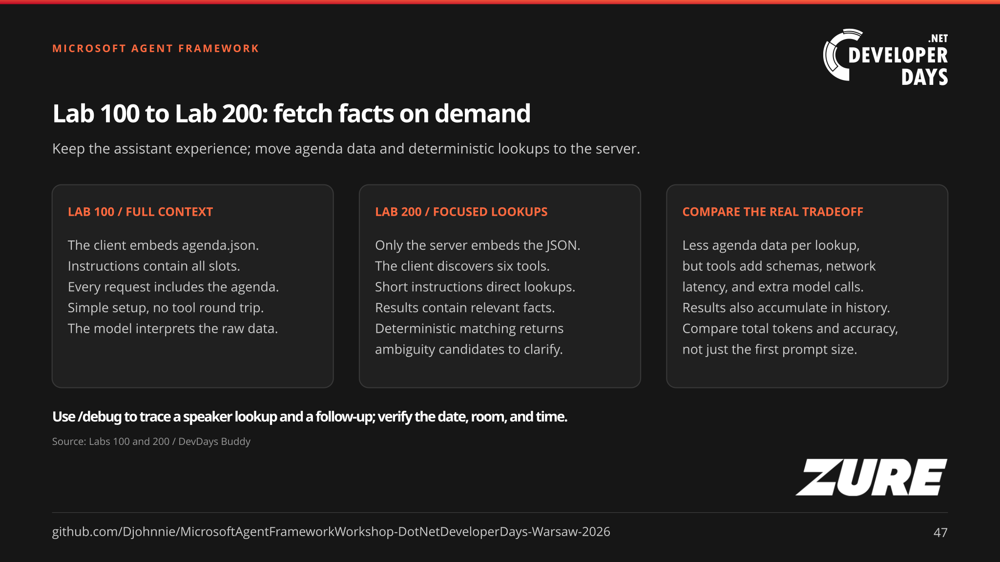

> **TL;DR:** Standardized discovery does not establish authorization or make remote content trustworthy.

Exercise 205 registers attributed tools, injects `TimeProvider`, and maps `/mcp`. Its clock belongs to the server machine, not necessarily the attendee. The workshop uses read-only localhost tools; protected deployments must authenticate endpoints, authorize resource access, validate inputs, and restrict credentials and exposed capabilities. Consequential actions need approval. Treat remote results as data, not behavioral instructions, and expose timeouts and failures rather than inventing successful results. The intentionally public Learn endpoint is not a justification for exposing private tools without authentication.

Read [MCP security best practices](https://modelcontextprotocol.io/docs/tutorials/security/security_best_practices).

### Slide 48 - Exercise 205: Host Date and Time MCP Tools
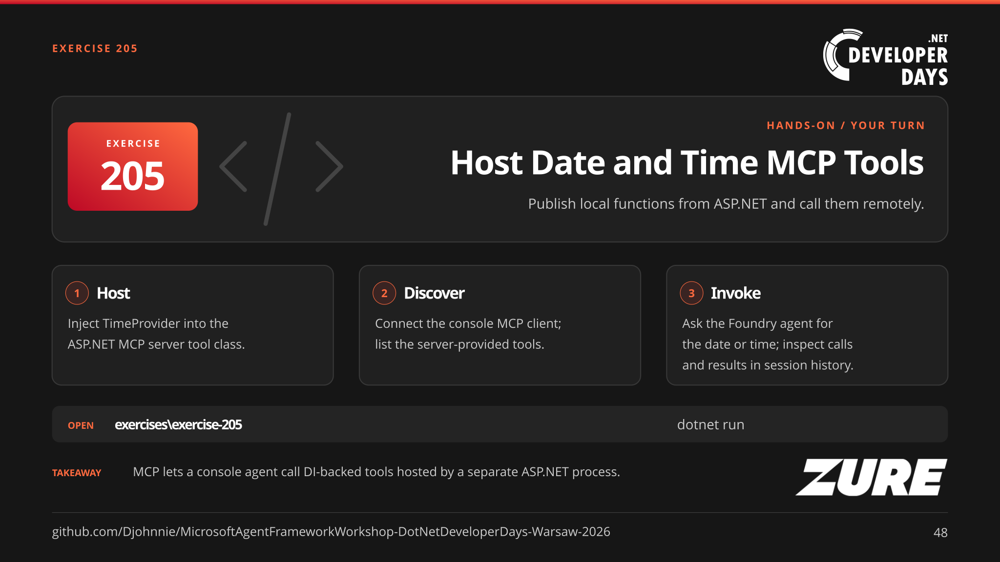

[Exercise 205 README](exercises/exercise-205/README.md)

> **TL;DR:** Host exercise 201's date and time tools in ASP.NET Core and call them from a separate agent client.

Exercise 205 splits MCP hosting and consumption into two projects. The ASP.NET server exposes the current local date and time through MCP over Streamable HTTP, with `TimeProvider` injected into the tool class by ASP.NET Core's DI container. The console client connects to `http://localhost:5285/mcp`, lists the server's tools, and provides them to a Foundry-backed `AIAgent`. Run the server first in one terminal, then the client in another.

### Slide 49 - Lab 100 to Lab 200: fetch facts on demand

> **TL;DR:** Focused tools reduce agenda context, but total cost includes tool round trips and growing history.

Lab 100 places the whole agenda in each request. Lab 200 keeps it only in the server, discovers six tools in the client, and sends short instructions plus selected results. Deterministic matching makes ambiguity explicit rather than asking the model to interpret the whole document. This can reduce agenda data per request, but tool schemas, network latency, additional model calls, and accumulated results still cost time and tokens. Compare total usage and accuracy across the same questions; do not assume MCP always makes a run cheaper. Use `/debug` to trace a speaker lookup and follow-up, then verify the returned room and Warsaw-local time.

### Slide 50 - Lab 200: DevDays Buddy MCP Tools
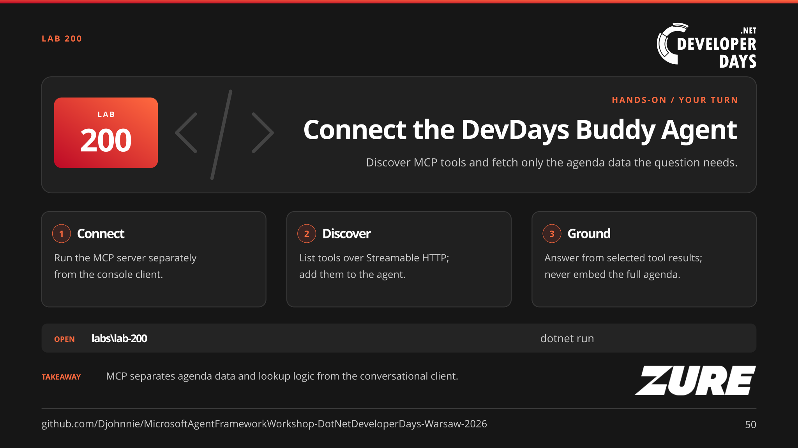

[Lab 200 README](labs/lab-200/README.md)

> **TL;DR:** Replace Lab 100's full-agenda prompt context with focused conference MCP tools.

Build an ASP.NET MCP server with an embedded `agenda.json` and six tools for conference information, dates, speakers, and sessions. A separate console agent discovers and invokes those tools; the entire agenda is never added to the agent's instructions.

### Slide 51 - Lab 200: Build the Agenda MCP Server

Implement tools for the conference name and description, dates, speaker list and speaker lookup, sessions by date, and session details by title or date and start time. Deterministic partial matching should return ambiguity candidates instead of silently selecting the wrong speaker or session.

### Slide 52 - Lab 200: Connect the DevDays Buddy Agent

Run the MCP server and console client as separate processes. The client discovers tools over Streamable HTTP and supplies them to an `AIAgent`; only the selected tool results and conversation history are sent to the model, not the full agenda document.

### Slide 53 - Part 3: Orchestrating agents and workflows

> **TL;DR:** Coordinate specialist agents and workflows to combine their work into one useful result.

Part 3 starts with the Terrible Startup Pitch: exercise 301 manually forwards a Founder's pitch to an Investor, and 302 uses the same agents with workflow executors and an edge. Lab 300 then splits a conference-day planning request between a Session Picker, Schedule Builder, and Plan Reviewer, adding structured state, C# constraints, and conditional revision edges. Compare when workflow structure helps and when simple sequential calls are enough.

### Slide 54 - Exercise 301: Terrible Startup Pitch - Manual Orchestration

[Exercise 301 README](exercises/exercise-301/README.md)

> **TL;DR:** Orchestration can start with two awaited calls and an explicit text handoff.

Create an enthusiastic Founder agent and a skeptical Investor agent using the same Foundry-backed `IChatClient`, but different instructions and fresh sessions. The Founder turns a theme into a ridiculous startup pitch; ordinary C# passes its exact `AgentResponse.Text` to the Investor, which returns a strength, objections, and a fictional FUND/PASS verdict. There are no workflows, tools, or revision loops.

### Slide 55 - Exercise 302: Terrible Startup Pitch - Workflow

[Exercise 302 README](exercises/exercise-302/README.md)

> **TL;DR:** Keep the two agents unchanged; replace the manual handoff with a directed workflow edge.

Wrap each agent in an `Executor<string, string>`, connect Founder to Investor with `WorkflowBuilder.AddEdge`, and register the Investor with `WithOutputFrom`. `InProcessExecution.RunStreamingAsync` runs the graph locally; executor completion shows the Founder's pitch and workflow output supplies the Investor's review. Both exercises use identical prompts, isolated sessions, and two agent invocations per completed round. The workflow makes the sequence observable rather than adding another model or a retry loop.

### Slide 56 - Lab 300: Plan My Conference Day

[Lab 300 README](labs/lab-300/README.md)

> **TL;DR:** Let three agents judge relevance while C# validates the schedule and workflow edges control revisions.

Build on Lab 200's MCP agenda server with a Session Picker, Schedule Builder, and Plan Reviewer. The console collects a conference date, availability, and interests; the workflow fetches one day's structured sessions through MCP and passes canonical IDs and recommendation reasons between agents. C# checks dates, time windows, duplicate IDs, candidate membership, and overlaps. Conditional edges send rejected plans back to the builder for at most two revisions, then return either an approved itinerary or an explicit no-approved-plan result. Stage panels expose handoffs and feedback. Starter and solution projects, plus deterministic graph checks without Foundry, are included.

### Slide 57 - Part 4: Making agents reliable and production-ready
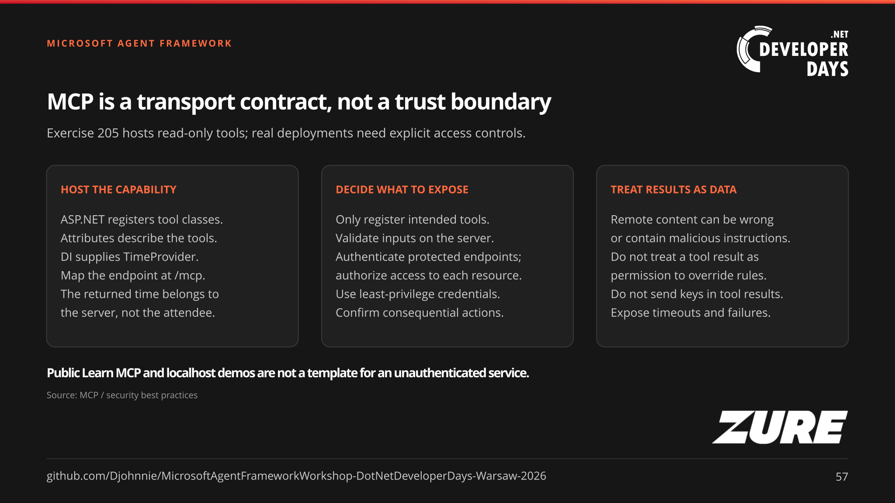

> **TL;DR:** Make agents reliable with validation, clear failure handling, logging, and tests.

Part 4 improves agent reliability with input and data validation, understandable error handling, concise logging, and tests for important behavior. Exercises 401-404 use a tiny Secret Snack Stash to separate claimed identity, console authentication, trusted in-process user context, and authenticated MCP requests. Application code—not an unsupported model claim—must enforce who can access protected data. Exercise 405 then calls an existing Microsoft Foundry agent using Microsoft Entra authentication and a server-side conversation.

### Slide 58 - Exercise 401: A Name Is Not Authentication
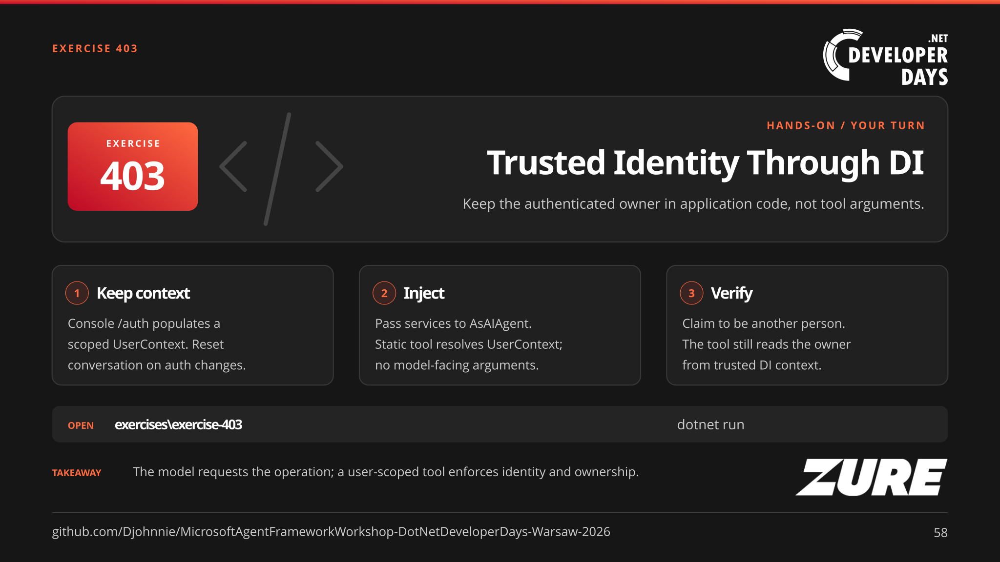

[Exercise 401 README](exercises/exercise-401/README.md)

> **TL;DR:** A name claimed in chat is not an authenticated identity.

Alice keeps stroopwafels in her keyboard drawer; Bob keeps gummy bears behind his rubber duck. The intentionally vulnerable `get_secret_snack(string userName)` tool takes its owner name from the agent without verifying credentials. Claim to be either person and inspect the tool output. Knowing a name is not permission to open that person's private stash.

### Slide 59 - Exercise 402: Authenticated but Model-Controlled Identity

[Exercise 402 README](exercises/exercise-402/README.md)

> **TL;DR:** Authenticate outside chat, but do not trust a model-controlled user ID for authorization.

The console's `/auth` command checks public demo credentials without sending the password to the model. After successful authentication, it creates an agent with the signed-in `userId` in its system instructions; questions are sent unchanged, and the agent supplies the ID to `get_secret_snack(string userId)`. This is still intentionally unsafe: the tool does not compare the supplied ID with trusted authentication state. System instructions and a model's refusal to substitute another ID are not an authorization boundary.

### Slide 60 - Exercise 403: Trusted User Context Through DI

[Exercise 403 README](exercises/exercise-403/README.md)

> **TL;DR:** Remove identity from tool arguments and inject a trusted user context.

Console `/auth` now populates a scoped `UserContext`. The scope's service provider is passed to `AsAIAgent`, which injects `IServiceProvider` into the static `SnackTools.GetSecretSnack` method, as in exercise 203. The tool resolves the context without exposing any model-facing parameters and denies signed-out or unknown users. A console scope belongs to one user at a time; sign-in attempts and sign-out clear conversation history to prevent cross-user leakage.

### Slide 61 - Exercise 404: Authenticated MCP Tools

[Exercise 404 README](exercises/exercise-404/README.md)

> **TL;DR:** Authenticate each MCP request with a protected bearer token and enforce ownership on the server.

Run a separate ASP.NET Core server and console client. `/auth` posts demo credentials to the server, which issues a five-minute opaque bearer token using ASP.NET Core authentication. The client keeps it in MCP HTTP headers, not model input. `/mcp` requires authorization, and a request-scoped user context reads identity from validated claims. The zero-argument tool returns only that owner's stash. Stateless Streamable HTTP keeps request identities separate. This is a loopback teaching login, not a production OAuth server; real deployments need HTTPS, an identity provider, and MCP-compatible OAuth authorization.

The [authentication boundary checks](tests/AuthenticationExercises/README.md) demonstrate the intentional flaws and enforce the corrected boundaries without Foundry or model calls.

### Slide 62 - Exercise 405: Call a Microsoft Foundry Agent

[Exercise 405 README](exercises/exercise-405/README.md)

> **TL;DR:** Call the existing `developerdays` Foundry agent using its agent-scoped Responses client.

Read the project URL from `FOUNDRY_ENDPOINT`, create an `AIProjectClient`, and select `developerdays` with `GetProjectResponsesClientForAgentEndpoint`. Reuse its pipeline and endpoint to create a server-side conversation, bind the conversation ID to a response client, and send `Hi developerdays`. The model, instructions, and tools live in Foundry. Unlike direct model inference, this agent endpoint requires Microsoft Entra ID (`DefaultAzureCredential`, locally via `az login`); `FOUNDRY_API_KEY` authentication is not supported, and no model deployment setting is needed.

### Slide 63 - Any questions?
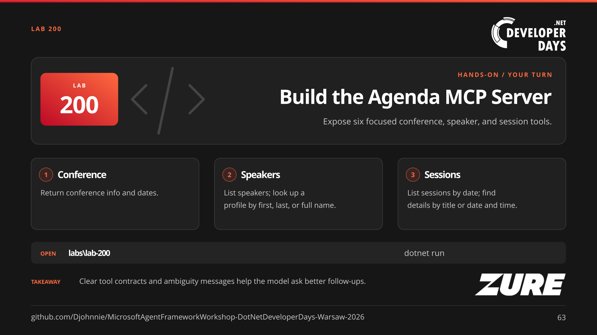

> **TL;DR:** You are wrapping up with time for questions and a link to the workshop materials.

Use the closing slide to ask questions and continue exploring the workshop repository. The link points attendees back to the materials so they can revisit the slides and exercises after the session.
